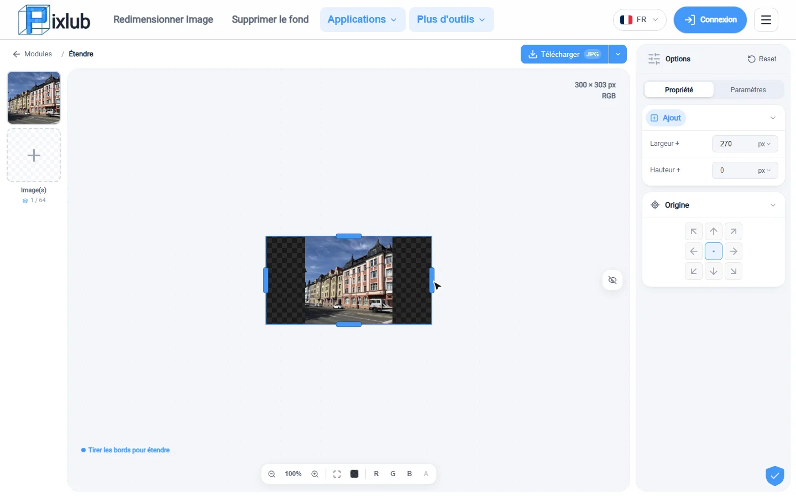

# Étendre

Agrandir la zone de l'image sans déformer son contenu : ajouter de la place autour.

**Catégorie** : Transformation · **Identifiant** : `extend` · [Référence API](./api.md)

## Où l'utiliser

- **[Page du module](https://pixlub.com/fr/module/extend)** : Déposez vos fichiers, réglez, téléchargez : le module seul, sans rien d'autre.
- **[Graphe d'image](https://pixlub.com/fr/image/graph)** : Reliez-le à d'autres modules pour composer un effet plus complexe.

## Entrées

Les fichiers que la page du module accepte : déposez-les sur la zone d’import, ou cliquez dessus pour parcourir. Un fichier d’un autre format est écarté, avec un message qui rappelle les formats permis.

| Entrée | Formats acceptés | Fichiers |
| --- | --- | --- |
| **Image(s)** (obligatoire) Image dont la zone est agrandie, sans déformer son contenu. | `PNG`, `JPEG`, `WebP`, `GIF`, `AVIF`, `BMP` | Un ou plusieurs : chaque image est traitée à part, avec les mêmes réglages |

Le nombre d’images traitées d’un coup dépend de votre offre.

Par l’API, les fichiers et leurs formats sont détaillés dans la [vue API](./api.md).

## Présentation vidéo

▶ [Voir la vidéo](../../../../assets/modules/extend/demo.fr.mp4) : Tirer un bord, saisir l'ajout, choisir l'origine.

1. `0:00` Importer une image
2. `0:02` Tirer un bord dans l’aperçu
3. `0:05` Saisir l’ajout
4. `0:09` Choisir l’origine
5. `0:15` Exporter le résultat

## Utilisation

1. **Importer**

   Déposez une ou plusieurs images.

2. **Ajouter de la place**

   Tirez un bord de l'image dans l'aperçu, ou saisissez **Largeur +** et **Hauteur +**.

3. **Choisir l'origine**

   La grille **Origine** fixe où reste l'image : au centre, la place se répartit tout autour.

## Réglages

| Réglage | Effet |
| --- | --- |
| **Largeur +** / **Hauteur +** | Place ajoutée, en pixels ou en %. |
| **Origine** | Position de l'image dans la nouvelle zone. |

La zone ajoutée est **transparente** : exportez en PNG ou WebP pour la garder.

## Astuces

- Pour un fond de couleur, posez Étendre dans le [graphe d'image](../../../../01-app/fr/02-image/01-image-graph.md) puis fusionnez sur un fond uni.
- Pour atteindre un format précis (carré, 16:9), utilisez plutôt la [taille du rendu](../../../../01-app/fr/01-module-independant.md#taille-du-rendu) en **Libre** avec **Contenir**.

## Exportation

Le bouton **Télécharger** enregistre le résultat dans le format du fichier importé : une photo JPEG ressort en JPEG. Le menu à sa droite ouvre les **Paramètres d’export** pour choisir un autre format, régler la qualité, la taille ou le fond, et propose **Copier l’image**.

Avec plusieurs images, le bouton devient **Téléchargement ZIP** ; le menu propose aussi les fichiers séparés, ou la seule image affichée.

- **[La modale d’exportation](../../../../01-app/fr/02-image/04-exportation.md)** : Tous les formats, leurs réglages, le traitement local ou serveur, les lots et le dossier local.
