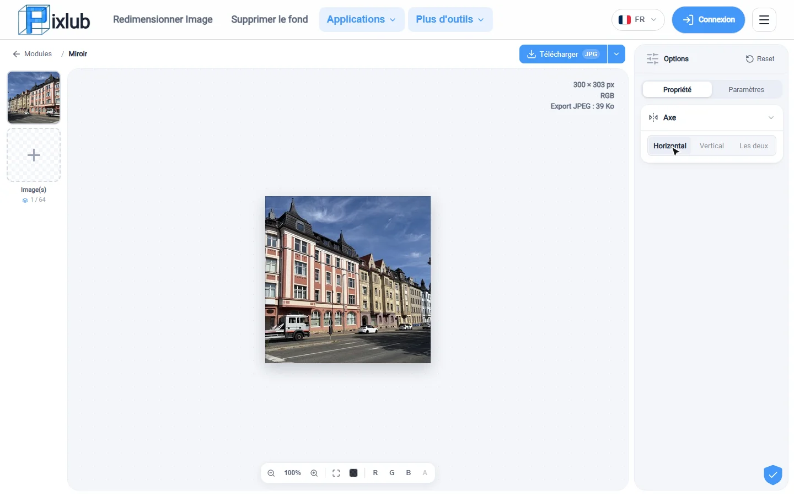

# Miroir

Retourner une image horizontalement, verticalement, ou les deux.

**Catégorie** : Transformation · **Identifiant** : `flip` · [Référence API](./api.md)

## Où l'utiliser

- **[Page du module](https://pixlub.com/fr/module/flip)** : Déposez vos fichiers, réglez, téléchargez : le module seul, sans rien d'autre.
- **[Graphe d'image](https://pixlub.com/fr/image/graph)** : Reliez-le à d'autres modules pour composer un effet plus complexe.

## Entrées

Les fichiers que la page du module accepte : déposez-les sur la zone d’import, ou cliquez dessus pour parcourir. Un fichier d’un autre format est écarté, avec un message qui rappelle les formats permis.

| Entrée | Formats acceptés | Fichiers |
| --- | --- | --- |
| **Image(s)** (obligatoire) Image à retourner. | `PNG`, `JPEG`, `WebP`, `GIF`, `AVIF`, `BMP` | Un ou plusieurs : chaque image est traitée à part, avec les mêmes réglages |

Le nombre d’images traitées d’un coup dépend de votre offre.

Par l’API, les fichiers et leurs formats sont détaillés dans la [vue API](./api.md).

## Présentation vidéo

▶ [Voir la vidéo](../../../../assets/modules/flip/demo.fr.mp4) : Miroir horizontal, vertical, puis les deux.

1. `0:00` Importer une image
2. `0:03` Miroir horizontal
3. `0:07` Vertical, ou les deux
4. `0:12` Exporter le résultat

## Utilisation

1. **Importer**

   Déposez une ou plusieurs images.

2. **Choisir l'axe**

   **Horizontal** inverse la gauche et la droite, **Vertical** le haut et le bas.

## Réglages

| Axe | Effet |
| --- | --- |
| **Horizontal** | Reflet de gauche à droite (par défaut). |
| **Vertical** | Reflet de haut en bas. |
| **Les deux** | Revient à un demi-tour (180°). |

## Astuces

- Un selfie inversé par l'appareil se corrige d'un miroir horizontal.
- Un texte présent sur l'image se lira à l'envers : vérifiez avant d'exporter.

## Exportation

Le bouton **Télécharger** enregistre le résultat dans le format du fichier importé : une photo JPEG ressort en JPEG. Le menu à sa droite ouvre les **Paramètres d’export** pour choisir un autre format, régler la qualité, la taille ou le fond, et propose **Copier l’image**.

Avec plusieurs images, le bouton devient **Téléchargement ZIP** ; le menu propose aussi les fichiers séparés, ou la seule image affichée.

- **[La modale d’exportation](../../../../01-app/fr/02-image/04-exportation.md)** : Tous les formats, leurs réglages, le traitement local ou serveur, les lots et le dossier local.
