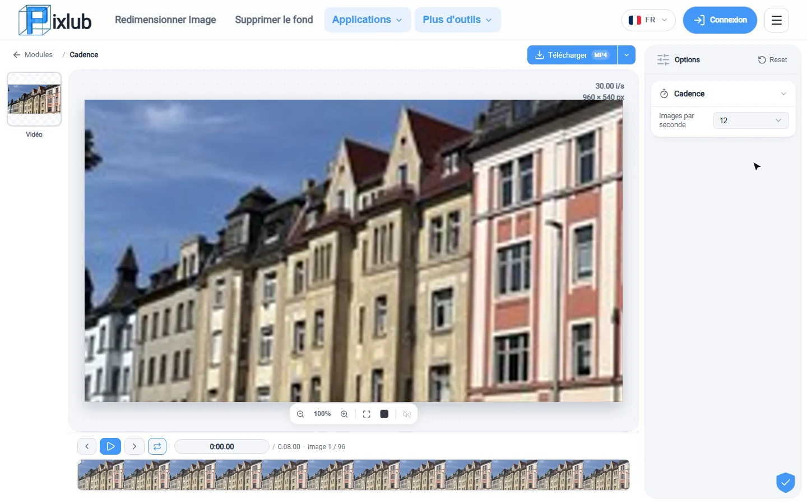

# Cadence

Changer le nombre d'images par seconde d'une vidéo.

**Catégorie** : Transformation · **Identifiant** : `frameRateVideo`

## Où l'utiliser

- **[Page du module](https://pixlub.com/fr/module/frameRateVideo)** : Déposez vos fichiers, réglez, téléchargez : le module seul, sans rien d'autre.
- **[Éditeur vidéo](https://pixlub.com/fr/video/editor)** : Posez-le en effet sur un plan du montage.

## Entrées

Les fichiers que la page du module accepte : déposez-les sur la zone d’import, ou cliquez dessus pour parcourir. Un fichier d’un autre format est écarté, avec un message qui rappelle les formats permis.

| Entrée | Formats acceptés | Fichiers |
| --- | --- | --- |
| **Vidéo** (obligatoire) Vidéo dont la cadence est réécrite. | `MP4`, `WebM`, `MOV`, `MKV` | Un fichier |

## Présentation vidéo

▶ [Voir la vidéo](../../../../assets/modules/frameRateVideo/demo.fr.mp4) : Baisser la cadence à 12 i/s, puis revenir à 25 i/s.

1. `0:00` Importer une vidéo
2. `0:03` Baisser la cadence : 12 i/s
3. `0:13` Cadence standard : 25 i/s
4. `0:21` Exporter le résultat

## Utilisation

1. **Importer**

   Déposez une vidéo. Sa cadence s'affiche en haut à droite de l'aperçu.

2. **Choisir la cadence**

   Lisez l'aperçu pour juger de la fluidité.

## Réglages

| Réglage | Effet |
| --- | --- |
| **Images par seconde** | **Source** (inchangée), ou 12, 15, 24, 25, 30, 50, 60 i/s. |

Baisser la cadence allège le fichier ; la monter au-delà de la source duplique des images sans ajouter de fluidité.

## Astuces

- 12 ou 15 i/s suffisent pour un GIF ou un aperçu léger.
- 24 i/s donne un rendu « cinéma », 25 ou 30 i/s celui de la vidéo classique.

## Exportation

Le résultat s’exporte depuis la page du module ou l’éditeur vidéo, en MP4, WebM ou un autre conteneur vidéo, sans quitter votre navigateur.

- **[L’éditeur vidéo](../../../../01-app/fr/03-video/01-video-editor.md)** : Monter, régler les effets et exporter une vidéo.
