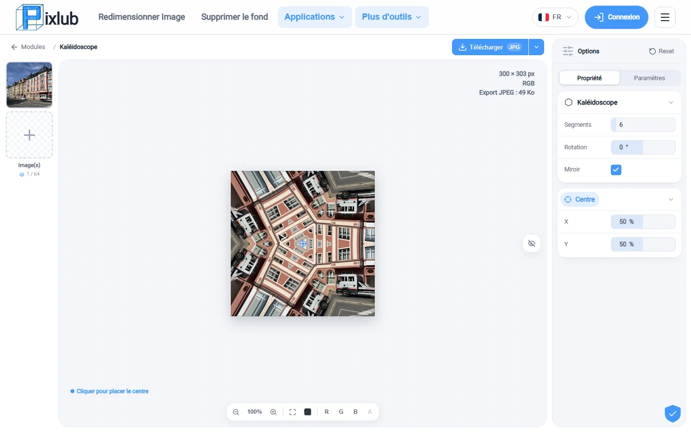

# Kaléidoscope

Répéter une part de l'image en symétrie autour d'un centre.

**Catégorie** : Transformation · **Identifiant** : `kaleidoscope` · [Référence API](./api.md)

## Où l'utiliser

- **[Page du module](https://pixlub.com/fr/module/kaleidoscope)** : Déposez vos fichiers, réglez, téléchargez : le module seul, sans rien d'autre.
- **[Graphe d'image](https://pixlub.com/fr/image/graph)** : Reliez-le à d'autres modules pour composer un effet plus complexe.

## Entrées

Les fichiers que la page du module accepte : déposez-les sur la zone d’import, ou cliquez dessus pour parcourir. Un fichier d’un autre format est écarté, avec un message qui rappelle les formats permis.

| Entrée | Formats acceptés | Fichiers |
| --- | --- | --- |
| **Image(s)** (obligatoire) Image dont un secteur est répété en symétrie radiale. | `PNG`, `JPEG`, `WebP`, `GIF`, `AVIF`, `BMP` | Un ou plusieurs : chaque image est traitée à part, avec les mêmes réglages |

Le nombre d’images traitées d’un coup dépend de votre offre.

Par l’API, les fichiers et leurs formats sont détaillés dans la [vue API](./api.md).

## Présentation vidéo

▶ [Voir la vidéo](../../../../assets/modules/kaleidoscope/demo.fr.mp4) : Segments, rotation, miroir et centre.

1. `0:00` Importer une image
2. `0:03` Nombre de segments
3. `0:06` Rotation et miroir
4. `0:14` Placer le centre
5. `0:16` Exporter le résultat

## Utilisation

1. **Importer**

   Déposez une ou plusieurs images.

2. **Choisir les segments**

   Plus il y a de **segments**, plus le motif est fin.

3. **Placer le centre**

   Cliquez dans l'aperçu : la part répétée part de ce point.

## Réglages

| Réglage | Effet |
| --- | --- |
| **Segments** | 1 à 64 parts autour du centre. |
| **Rotation** | −180° à 180°. Change la part de l'image reprise. |
| **Miroir** | Coché : une part sur deux est inversée, les raccords disparaissent. |
| **Centre X** / **Y** | Position du centre, en %. |

## Astuces

- 6 ou 8 segments avec le miroir donnent un motif de rosace régulier.
- Une image très colorée donne les motifs les plus vifs.

## Exportation

Le bouton **Télécharger** enregistre le résultat dans le format du fichier importé : une photo JPEG ressort en JPEG. Le menu à sa droite ouvre les **Paramètres d’export** pour choisir un autre format, régler la qualité, la taille ou le fond, et propose **Copier l’image**.

Avec plusieurs images, le bouton devient **Téléchargement ZIP** ; le menu propose aussi les fichiers séparés, ou la seule image affichée.

- **[La modale d’exportation](../../../../01-app/fr/02-image/04-exportation.md)** : Tous les formats, leurs réglages, le traitement local ou serveur, les lots et le dossier local.
