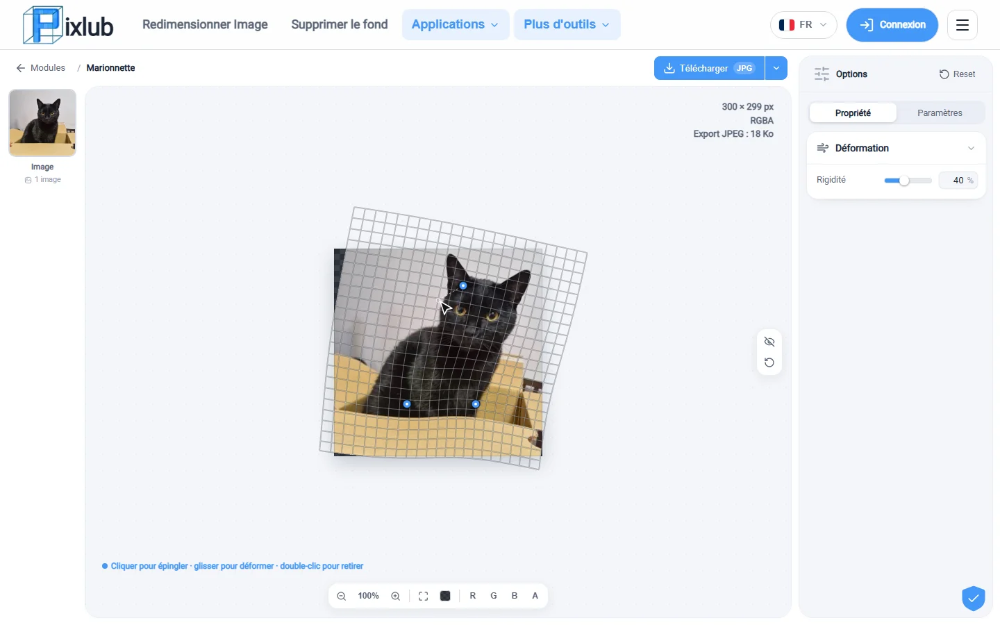

# Marionnette

Déformer une image en plaçant des épingles et en les déplaçant.

**Catégorie** : Transformation · **Identifiant** : `puppet` · [Référence API](./api.md)

## Où l'utiliser

- **[Page du module](https://pixlub.com/fr/module/puppet)** : Déposez vos fichiers, réglez, téléchargez : le module seul, sans rien d'autre.
- **[Graphe d'image](https://pixlub.com/fr/image/graph)** : Reliez-le à d'autres modules pour composer un effet plus complexe.

## Entrées

Les fichiers que la page du module accepte : déposez-les sur la zone d’import, ou cliquez dessus pour parcourir. Un fichier d’un autre format est écarté, avec un message qui rappelle les formats permis.

| Entrée | Formats acceptés | Fichiers |
| --- | --- | --- |
| **Image** (obligatoire) Image déformée par les épingles. | `PNG`, `JPEG`, `WebP`, `GIF`, `AVIF`, `BMP` | Un fichier |

Par l’API, les fichiers et leurs formats sont détaillés dans la [vue API](./api.md).

## Présentation vidéo

▶ [Voir la vidéo](../../../../assets/modules/puppet/demo.fr.mp4) : Poser des épingles, déformer, régler la rigidité.

1. `0:00` Importer un personnage
2. `0:02` Poser des épingles
3. `0:07` Glisser pour déformer
4. `0:11` Rigidité
5. `0:20` Double-clic : retirer une épingle
6. `0:23` Exporter le résultat

## Utilisation

1. **Importer**

   Déposez une image, un personnage par exemple.

2. **Épingler**

   Cliquez dans l'aperçu pour poser des épingles sur les parties à tenir ou à bouger.

3. **Déformer**

   Glissez une épingle : l'image suit, les autres épingles restent en place.

## Réglages

| Réglage | Effet |
| --- | --- |
| **Rigidité** | 0 à 100 %. Haute : l'image se plie moins et garde ses formes. Basse : elle suit librement. |
| **Épingles** | Cible de chaque épingle (X, Y en % de l'image), animable une à une dans le graphe. |

Un **double-clic** sur une épingle la retire.

## Astuces

- Posez d'abord des épingles fixes (pieds, corps) avant de bouger une tête ou un bras.
- Le module traite une seule image à la fois : les épingles sont propres à chaque image.

## Exportation

Le bouton **Télécharger** enregistre le résultat dans le format du fichier importé : une photo JPEG ressort en JPEG. Le menu à sa droite ouvre les **Paramètres d’export** pour choisir un autre format, régler la qualité, la taille ou le fond, et propose **Copier l’image**.

- **[La modale d’exportation](../../../../01-app/fr/02-image/04-exportation.md)** : Tous les formats, leurs réglages, le traitement local ou serveur, les lots et le dossier local.
