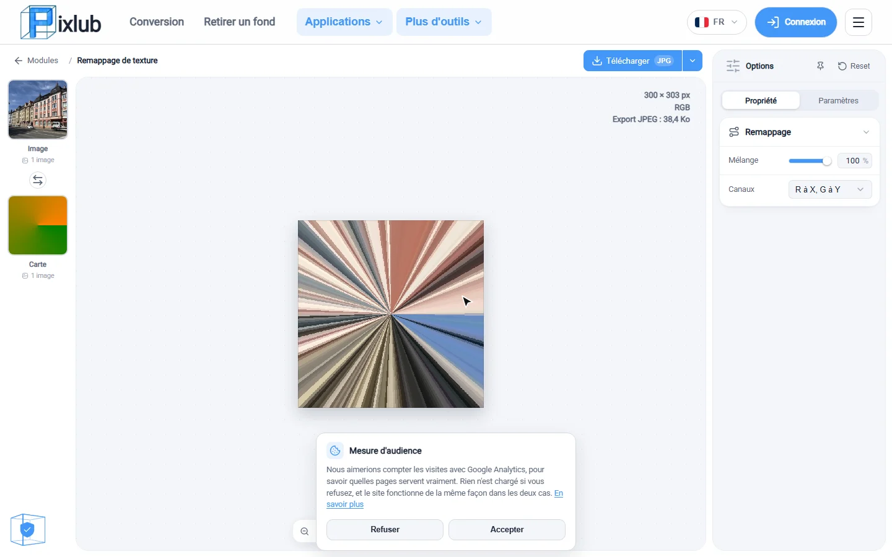

# Remappage de texture

Redessiner une image en lisant, pour chaque pixel, la position donnée par une carte.

**Catégorie** : Transformation · **Identifiant** : `remap` · [Référence API](./api.md)

## Où l'utiliser

- **[Page du module](https://pixlub.com/fr/module/remap)** : Déposez vos fichiers, réglez, téléchargez : le module seul, sans rien d'autre.
- **[Graphe d'image](https://pixlub.com/fr/image/graph)** : Reliez-le à d'autres modules pour composer un effet plus complexe.

## Entrées

Les fichiers que la page du module accepte : déposez-les sur la zone d’import, ou cliquez dessus pour parcourir. Un fichier d’un autre format est écarté, avec un message qui rappelle les formats permis.

| Entrée | Formats acceptés | Fichiers |
| --- | --- | --- |
| **Image** (obligatoire) Texture lue, répétée au-delà de ses bords. | `PNG`, `JPEG`, `WebP`, `GIF`, `AVIF`, `BMP` | Un fichier |
| **Carte** (obligatoire) Image dont le rouge donne la position X lue et le vert la position Y. | `PNG`, `JPEG`, `WebP`, `GIF`, `AVIF`, `BMP` | Un fichier |

Par l’API, les fichiers et leurs formats sont détaillés dans la [vue API](./api.md).

## Présentation vidéo

▶ [Voir la vidéo](../../../../assets/modules/remap/demo.fr.mp4) : Texture, carte, mélange et canaux.

1. `0:00` Importer une image
2. `0:03` Ajouter une carte radiale
3. `0:06` Doser le mélange
4. `0:16` Canaux lus dans la carte
5. `0:21` Exporter le résultat

## Utilisation

1. **Importer la texture**

   Déposez l'image à relire dans la case **Image** ; elle se répète au-delà de ses bords.

2. **Ajouter la carte**

   Déposez la carte dans la case **Carte** : son rouge donne la colonne lue, son vert la ligne.

3. **Doser**

   Réglez le **mélange**, puis les **canaux** lus dans la carte.

## Réglages

| Réglage | Effet |
| --- | --- |
| **Mélange** | 0 % laisse l'image intacte, 100 % lit entièrement la carte. |
| **Canaux** | **R à X, G à Y** : 0 = bord gauche (ou haut), 100 % = bord droit (ou bas). **Luminance** : la clarté donne la position sur les deux axes. |

## Astuces

- Un [Dégradé](../../07-generate/gradient/README.md) radial noir → rouge (vert à 50 %) étire un bruit en rayons : animer son angle les fait tourner.
- Contrairement au [Déplacement](../displace/README.md), qui pousse chaque pixel autour de sa place, la carte donne ici une position absolue.

## Exportation

Le bouton **Télécharger** enregistre le résultat dans le format du fichier importé : une photo JPEG ressort en JPEG. Le menu à sa droite ouvre les **Paramètres d’export** pour choisir un autre format, régler la qualité, la taille ou le fond, et propose **Copier l’image**.

- **[La modale d’exportation](../../../../01-app/fr/02-image/04-exportation.md)** : Tous les formats, leurs réglages, le traitement local ou serveur, les lots et le dossier local.
