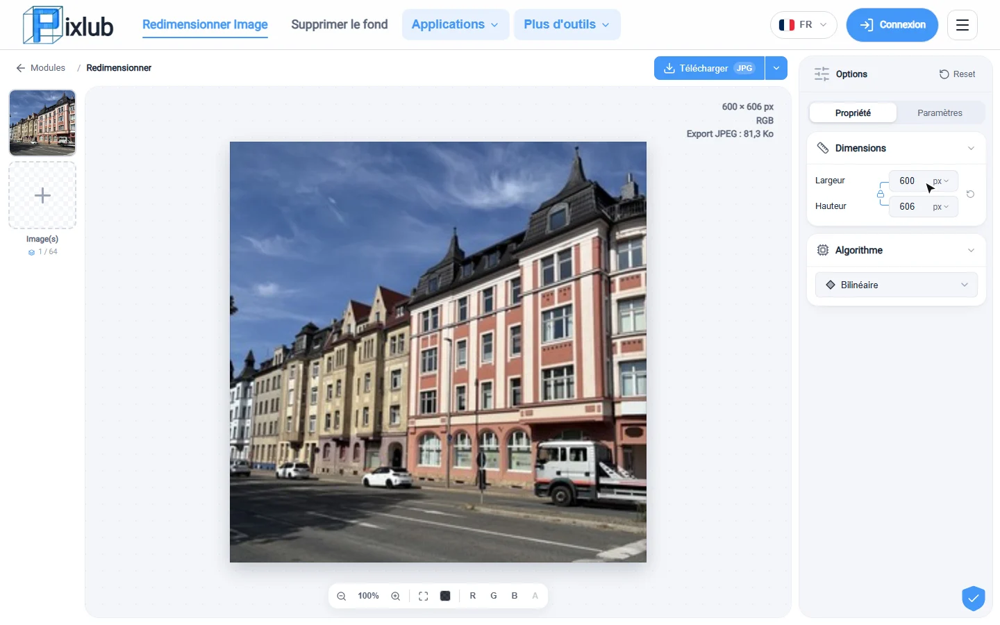
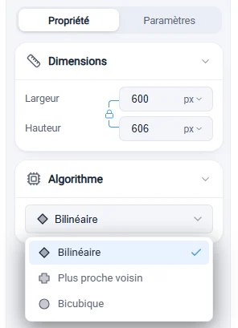

# Redimensionner

Changer la largeur et la hauteur d'une image, en pixels, en pourcentage, en centimètres ou en pouces.

**Catégorie** : Transformation · **Identifiant** : `resize` · [Référence API](./api.md)

## Où l'utiliser

- **[Page du module](https://pixlub.com/fr/module/resize)** : Déposez vos fichiers, réglez, téléchargez : le module seul, sans rien d'autre.
- **[Graphe d'image](https://pixlub.com/fr/image/graph)** : Reliez-le à d'autres modules pour composer un effet plus complexe.

## Entrées

Les fichiers que la page du module accepte : déposez-les sur la zone d’import, ou cliquez dessus pour parcourir. Un fichier d’un autre format est écarté, avec un message qui rappelle les formats permis.

| Entrée | Formats acceptés | Fichiers |
| --- | --- | --- |
| **Image(s)** (obligatoire) Image à redimensionner. | `PNG`, `JPEG`, `WebP`, `GIF`, `AVIF`, `BMP` | Un ou plusieurs : chaque image est traitée à part, avec les mêmes réglages |

Le nombre d’images traitées d’un coup dépend de votre offre.

Par l’API, les fichiers et leurs formats sont détaillés dans la [vue API](./api.md).

## Présentation vidéo

▶ [Voir la vidéo](../../../../assets/modules/resize/demo.fr.mp4) : Largeur, cadenas, unités, algorithmes et lot d'images.

1. `0:00` Importer une image
2. `0:02` Largeur : la hauteur suit
3. `0:06` Cadenas ouvert : largeur et hauteur libres
4. `0:13` Unités : pourcentage, centimètres, résolution
5. `0:29` Algorithmes comparés de près
6. `0:43` Un lot de plusieurs images
7. `0:51` Exporter le résultat

## Utilisation

1. **Importer**

   Déposez une ou plusieurs images. Le coin de l'aperçu affiche leur taille.

2. **Donner une dimension**

   Tapez la largeur **ou** la hauteur : cadenas fermé, l'autre suit les proportions.

3. **Choisir l'algorithme**

   **Bilinéaire** convient à la plupart des images.

4. **Exporter**

   **Télécharger**, ou **Téléchargement ZIP** pour un lot.

## Réglages

### Dimensions

| Unité | Valeurs |
| --- | --- |
| **px** | 0 à 8000 |
| **%** | 0 à 800 % de la taille d'origine |
| **cm** / **in** | 0 à 500 cm, 0 à 200 in, selon la **résolution** (300 ppp par défaut) |

Les deux côtés partagent la même unité. Un champ vide (« Auto ») suit les proportions, ou garde la taille d'origine si le cadenas est ouvert.

| Cadenas | Effet |
| --- | --- |
| **Fermé** | Un seul côté compte, l'autre suit. Dans un lot, chaque image garde ses proportions. |
| **Ouvert** | Les deux côtés sont libres : l'image peut se déformer. |

### Algorithme

*Plus proche voisin, bilinéaire, bicubique.*

| Algorithme | Pour |
| --- | --- |
| **Bilinéaire** | La plupart des images. |
| **Plus proche voisin** | Pixel art, icônes : bords nets. |
| **Bicubique** | Réduire une photo en gardant le détail. |

## Astuces

- Un format exact sans déformation : onglet **Paramètres**, taille **Libre** et **Couvrir**. Voir [Taille du rendu](../../../../01-app/fr/01-module-independant.md#taille-du-rendu).
- Pour ×2 ou ×0,5, [Redimensionner (Facteur)](../resizeFactor/README.md) est plus direct.
- Agrandir n'ajoute pas de détail : partez de la plus grande image disponible.

## Exportation

Le bouton **Télécharger** enregistre le résultat dans le format du fichier importé : une photo JPEG ressort en JPEG. Le menu à sa droite ouvre les **Paramètres d’export** pour choisir un autre format, régler la qualité, la taille ou le fond, et propose **Copier l’image**.

Avec plusieurs images, le bouton devient **Téléchargement ZIP** ; le menu propose aussi les fichiers séparés, ou la seule image affichée.

- **[La modale d’exportation](../../../../01-app/fr/02-image/04-exportation.md)** : Tous les formats, leurs réglages, le traitement local ou serveur, les lots et le dossier local.
