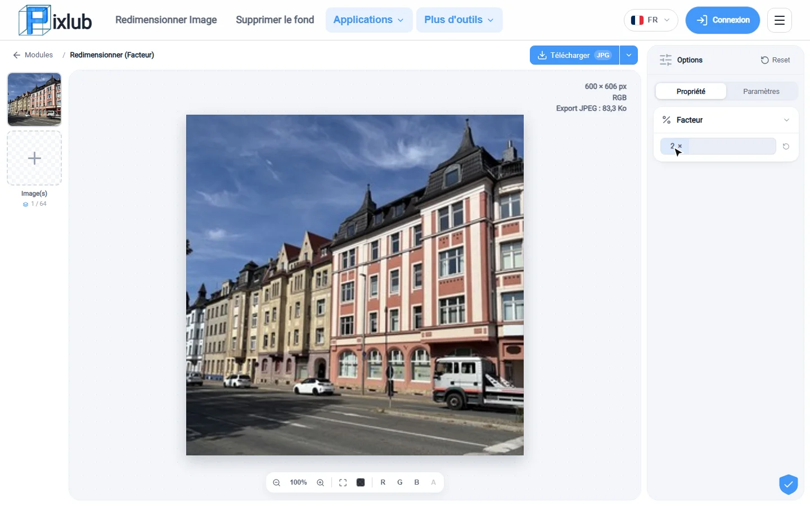

# Redimensionner (Facteur)

Agrandir ou réduire une image par un facteur : ×2, ×0,5…

**Catégorie** : Transformation · **Identifiant** : `resizeFactor` · [Référence API](./api.md)

## Où l'utiliser

- **[Page du module](https://pixlub.com/fr/module/resizeFactor)** : Déposez vos fichiers, réglez, téléchargez : le module seul, sans rien d'autre.
- **[Graphe d'image](https://pixlub.com/fr/image/graph)** : Reliez-le à d'autres modules pour composer un effet plus complexe.

## Entrées

Les fichiers que la page du module accepte : déposez-les sur la zone d’import, ou cliquez dessus pour parcourir. Un fichier d’un autre format est écarté, avec un message qui rappelle les formats permis.

| Entrée | Formats acceptés | Fichiers |
| --- | --- | --- |
| **Image(s)** (obligatoire) Image mise à l'échelle. | `PNG`, `JPEG`, `WebP`, `GIF`, `AVIF`, `BMP` | Un ou plusieurs : chaque image est traitée à part, avec les mêmes réglages |

Le nombre d’images traitées d’un coup dépend de votre offre.

Par l’API, les fichiers et leurs formats sont détaillés dans la [vue API](./api.md).

## Présentation vidéo

▶ [Voir la vidéo](../../../../assets/modules/resizeFactor/demo.fr.mp4) : Doubler, ajuster à la souris, puis réduire de moitié.

1. `0:00` Importer une image
2. `0:02` Agrandir : facteur 2
3. `0:06` Glisser pour ajuster
4. `0:11` Réduire de moitié : 0,5
5. `0:15` Exporter le résultat

## Utilisation

1. **Importer**

   Déposez une ou plusieurs images.

2. **Choisir le facteur**

   Tapez la valeur, ou glissez sur la barre. Les proportions sont toujours gardées.

3. **Exporter**

   **Télécharger**, ou **Téléchargement ZIP** pour un lot.

## Réglages

| Réglage | Effet |
| --- | --- |
| **Facteur** | De ×0,05 à ×8. **2** double la taille, **0,5** la divise par deux. |

## Astuces

- Pour une taille précise en pixels ou en centimètres, utilisez [Redimensionner](../resize/README.md).
- Pour du pixel art, agrandissez d'un facteur entier (×2, ×3) afin de garder des pixels réguliers.

## Exportation

Le bouton **Télécharger** enregistre le résultat dans le format du fichier importé : une photo JPEG ressort en JPEG. Le menu à sa droite ouvre les **Paramètres d’export** pour choisir un autre format, régler la qualité, la taille ou le fond, et propose **Copier l’image**.

Avec plusieurs images, le bouton devient **Téléchargement ZIP** ; le menu propose aussi les fichiers séparés, ou la seule image affichée.

- **[La modale d’exportation](../../../../01-app/fr/02-image/04-exportation.md)** : Tous les formats, leurs réglages, le traitement local ou serveur, les lots et le dossier local.
