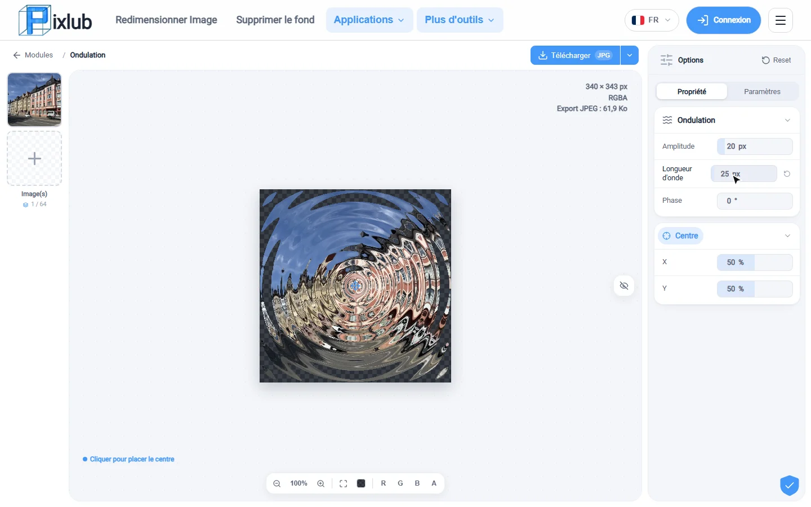

# Ondulation

Déformer une image en anneaux concentriques, comme une goutte dans l'eau.

**Catégorie** : Transformation · **Identifiant** : `ripple` · [Référence API](./api.md)

## Où l'utiliser

- **[Page du module](https://pixlub.com/fr/module/ripple)** : Déposez vos fichiers, réglez, téléchargez : le module seul, sans rien d'autre.
- **[Graphe d'image](https://pixlub.com/fr/image/graph)** : Reliez-le à d'autres modules pour composer un effet plus complexe.

## Entrées

Les fichiers que la page du module accepte : déposez-les sur la zone d’import, ou cliquez dessus pour parcourir. Un fichier d’un autre format est écarté, avec un message qui rappelle les formats permis.

| Entrée | Formats acceptés | Fichiers |
| --- | --- | --- |
| **Image(s)** (obligatoire) Image déformée par l'ondulation. | `PNG`, `JPEG`, `WebP`, `GIF`, `AVIF`, `BMP` | Un ou plusieurs : chaque image est traitée à part, avec les mêmes réglages |

Le nombre d’images traitées d’un coup dépend de votre offre.

Par l’API, les fichiers et leurs formats sont détaillés dans la [vue API](./api.md).

## Présentation vidéo

▶ [Voir la vidéo](../../../../assets/modules/ripple/demo.fr.mp4) : Amplitude, longueur d'onde, phase et centre.

1. `0:00` Importer une image
2. `0:02` Amplitude et longueur d’onde
3. `0:07` Phase
4. `0:11` Placer le centre
5. `0:14` Exporter le résultat

## Utilisation

1. **Importer**

   Déposez une ou plusieurs images.

2. **Régler les vagues**

   L'**amplitude** fixe leur hauteur, la **longueur d'onde** l'écart entre deux anneaux.

3. **Placer le centre**

   Cliquez dans l'aperçu à l'endroit où tombe la goutte.

## Réglages

| Réglage | Effet |
| --- | --- |
| **Amplitude** | 0 à 200 px. |
| **Longueur d'onde** | 2 à 500 px entre deux crêtes. |
| **Phase** | 0° à 360°. Fait avancer les anneaux. |
| **Centre X** / **Y** | Position du centre, en %. |

## Astuces

- Animez la **phase** de 0° à 360° dans le [graphe d'image](../../../../01-app/fr/02-image/01-image-graph.md) pour des vagues qui s'éloignent en boucle.
- Pour des vagues droites plutôt que des anneaux : [Onde](../wave/README.md).

## Exportation

Le bouton **Télécharger** enregistre le résultat dans le format du fichier importé : une photo JPEG ressort en JPEG. Le menu à sa droite ouvre les **Paramètres d’export** pour choisir un autre format, régler la qualité, la taille ou le fond, et propose **Copier l’image**.

Avec plusieurs images, le bouton devient **Téléchargement ZIP** ; le menu propose aussi les fichiers séparés, ou la seule image affichée.

- **[La modale d’exportation](../../../../01-app/fr/02-image/04-exportation.md)** : Tous les formats, leurs réglages, le traitement local ou serveur, les lots et le dossier local.
