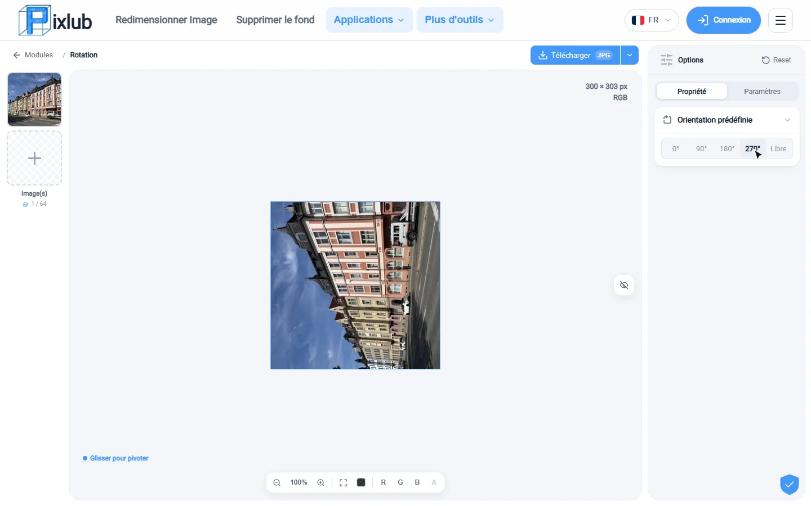

# Rotation

Faire pivoter une image d'un quart de tour ou d'un angle libre.

**Catégorie** : Transformation · **Identifiant** : `rotate` · [Référence API](./api.md)

## Où l'utiliser

- **[Page du module](https://pixlub.com/fr/module/rotate)** : Déposez vos fichiers, réglez, téléchargez : le module seul, sans rien d'autre.
- **[Graphe d'image](https://pixlub.com/fr/image/graph)** : Reliez-le à d'autres modules pour composer un effet plus complexe.

## Entrées

Les fichiers que la page du module accepte : déposez-les sur la zone d’import, ou cliquez dessus pour parcourir. Un fichier d’un autre format est écarté, avec un message qui rappelle les formats permis.

| Entrée | Formats acceptés | Fichiers |
| --- | --- | --- |
| **Image(s)** (obligatoire) Image à faire pivoter. | `PNG`, `JPEG`, `WebP`, `GIF`, `AVIF`, `BMP` | Un ou plusieurs : chaque image est traitée à part, avec les mêmes réglages |

Le nombre d’images traitées d’un coup dépend de votre offre.

Par l’API, les fichiers et leurs formats sont détaillés dans la [vue API](./api.md).

## Présentation vidéo

▶ [Voir la vidéo](../../../../assets/modules/rotate/demo.fr.mp4) : Orientations toutes prêtes, angle libre, rotation à la souris.

1. `0:00` Importer une image
2. `0:02` Orientations toutes prêtes
3. `0:06` Angle libre
4. `0:12` Pivoter à la souris
5. `0:15` Exporter le résultat

## Utilisation

1. **Importer**

   Déposez une ou plusieurs images.

2. **Choisir l'orientation**

   **90°**, **180°** ou **270°** en un clic.

3. **Ou un angle libre**

   Choisissez **Libre**, puis tapez l'angle ou faites pivoter l'image en la glissant dans l'aperçu.

## Réglages

| Réglage | Effet |
| --- | --- |
| **Orientation** | 0°, 90°, 180°, 270° ou **Libre**. |
| **Angle** | En mode Libre : −180° à 180°. |

Avec un angle libre, l'image s'agrandit pour garder les coins ; les angles ajoutés sont **transparents**.

## Astuces

- Pour redresser une photo penchée, un angle de 1° à 5° suffit souvent ; recadrez ensuite avec [Rogner](../crop/README.md).
- Pour retourner l'image en miroir plutôt que la tourner, utilisez [Miroir](../flip/README.md).

## Exportation

Le bouton **Télécharger** enregistre le résultat dans le format du fichier importé : une photo JPEG ressort en JPEG. Le menu à sa droite ouvre les **Paramètres d’export** pour choisir un autre format, régler la qualité, la taille ou le fond, et propose **Copier l’image**.

Avec plusieurs images, le bouton devient **Téléchargement ZIP** ; le menu propose aussi les fichiers séparés, ou la seule image affichée.

- **[La modale d’exportation](../../../../01-app/fr/02-image/04-exportation.md)** : Tous les formats, leurs réglages, le traitement local ou serveur, les lots et le dossier local.
