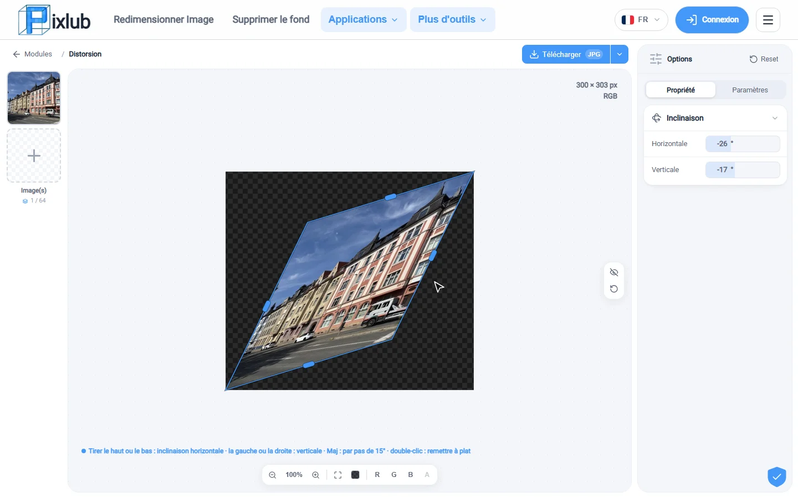

# Distorsion

Incliner une image horizontalement ou verticalement (cisaillement).

**Catégorie** : Transformation · **Identifiant** : `skew` · [Référence API](./api.md)

## Où l'utiliser

- **[Page du module](https://pixlub.com/fr/module/skew)** : Déposez vos fichiers, réglez, téléchargez : le module seul, sans rien d'autre.
- **[Graphe d'image](https://pixlub.com/fr/image/graph)** : Reliez-le à d'autres modules pour composer un effet plus complexe.

## Entrées

Les fichiers que la page du module accepte : déposez-les sur la zone d’import, ou cliquez dessus pour parcourir. Un fichier d’un autre format est écarté, avec un message qui rappelle les formats permis.

| Entrée | Formats acceptés | Fichiers |
| --- | --- | --- |
| **Image(s)** (obligatoire) Image à incliner. | `PNG`, `JPEG`, `WebP`, `GIF`, `AVIF`, `BMP` | Un ou plusieurs : chaque image est traitée à part, avec les mêmes réglages |

Le nombre d’images traitées d’un coup dépend de votre offre.

Par l’API, les fichiers et leurs formats sont détaillés dans la [vue API](./api.md).

## Présentation vidéo

▶ [Voir la vidéo](../../../../assets/modules/skew/demo.fr.mp4) : Tirer un bord, régler les angles, remettre à plat.

1. `0:00` Importer une image
2. `0:02` Tirer un bord pour incliner
3. `0:09` Régler les angles
4. `0:15` Exporter le résultat

## Utilisation

1. **Importer**

   Déposez une ou plusieurs images.

2. **Incliner à la souris**

   Tirez le haut ou le bas de l'image pour l'incliner horizontalement, la gauche ou la droite pour l'incliner verticalement.

3. **Ajuster**

   Tapez les angles dans le panneau. Un double-clic dans l'aperçu remet l'image à plat.

## Réglages

| Réglage | Effet |
| --- | --- |
| **Horizontale** | −80° à 80°. Décale le haut par rapport au bas. |
| **Verticale** | −80° à 80°. Décale la gauche par rapport à la droite. |

L'image s'élargit pour rester entière ; les coins ajoutés sont **transparents**.

## Astuces

- Maintenez **Maj** en tirant un bord pour avancer par pas de 15°.
- Pour placer chaque coin librement, utilisez [Perspective](../cornerPin/README.md).

## Exportation

Le bouton **Télécharger** enregistre le résultat dans le format du fichier importé : une photo JPEG ressort en JPEG. Le menu à sa droite ouvre les **Paramètres d’export** pour choisir un autre format, régler la qualité, la taille ou le fond, et propose **Copier l’image**.

Avec plusieurs images, le bouton devient **Téléchargement ZIP** ; le menu propose aussi les fichiers séparés, ou la seule image affichée.

- **[La modale d’exportation](../../../../01-app/fr/02-image/04-exportation.md)** : Tous les formats, leurs réglages, le traitement local ou serveur, les lots et le dossier local.
