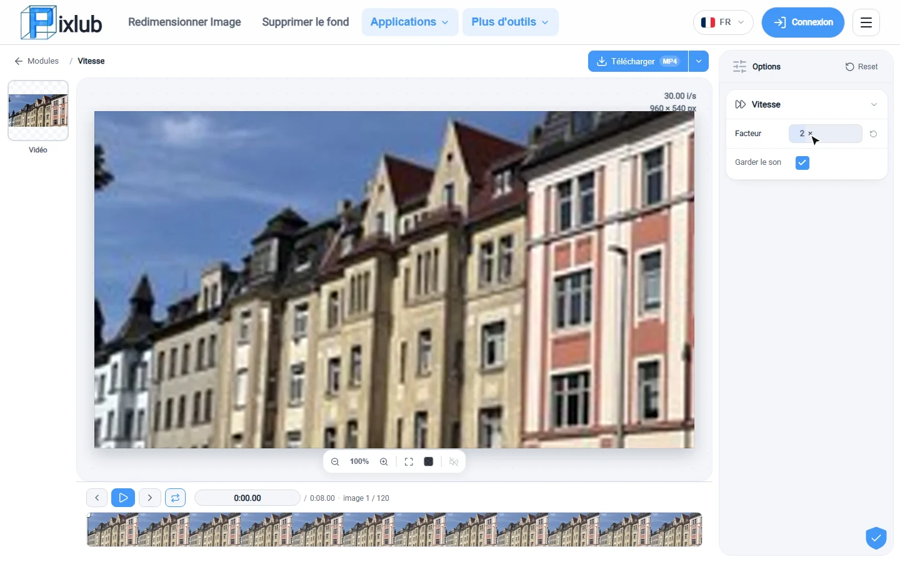

# Vitesse

Accélérer ou ralentir une vidéo.

**Catégorie** : Transformation · **Identifiant** : `speedVideo`

## Où l'utiliser

- **[Page du module](https://pixlub.com/fr/module/speedVideo)** : Déposez vos fichiers, réglez, téléchargez : le module seul, sans rien d'autre.
- **[Éditeur vidéo](https://pixlub.com/fr/video/editor)** : Posez-le en effet sur un plan du montage.

## Entrées

Les fichiers que la page du module accepte : déposez-les sur la zone d’import, ou cliquez dessus pour parcourir. Un fichier d’un autre format est écarté, avec un message qui rappelle les formats permis.

| Entrée | Formats acceptés | Fichiers |
| --- | --- | --- |
| **Vidéo** (obligatoire) Vidéo accélérée ou ralentie. | `MP4`, `WebM`, `MOV`, `MKV` | Un fichier |

## Présentation vidéo

▶ [Voir la vidéo](../../../../assets/modules/speedVideo/demo.fr.mp4) : Accélérer ×2, puis ralentir ×0,5.

1. `0:00` Importer une vidéo
2. `0:03` Accélérer : facteur 2
3. `0:11` Ralentir : facteur 0,5
4. `0:19` Exporter le résultat

## Utilisation

1. **Importer**

   Déposez une vidéo.

2. **Choisir le facteur**

   Au-dessus de 1, la vidéo accélère ; en dessous, elle ralentit. Lisez l'aperçu pour juger.

## Réglages

| Réglage | Effet |
| --- | --- |
| **Facteur** | ×0,25 à ×8. **2** divise la durée par deux. |
| **Garder le son** | Coché : le son suit la vitesse. Décoché : la vidéo sort muette, plus vite. |

La cadence ne change pas : ce sont les images prises dans la source qui changent.

## Astuces

- Pour un ralenti fluide, partez d'une vidéo filmée à haute cadence (50 ou 60 i/s).
- Pour réduire le poids sans changer la durée, baissez plutôt la [Cadence](../frameRateVideo/README.md).

## Exportation

Le résultat s’exporte depuis la page du module ou l’éditeur vidéo, en MP4, WebM ou un autre conteneur vidéo, sans quitter votre navigateur.

- **[L’éditeur vidéo](../../../../01-app/fr/03-video/01-video-editor.md)** : Monter, régler les effets et exporter une vidéo.
