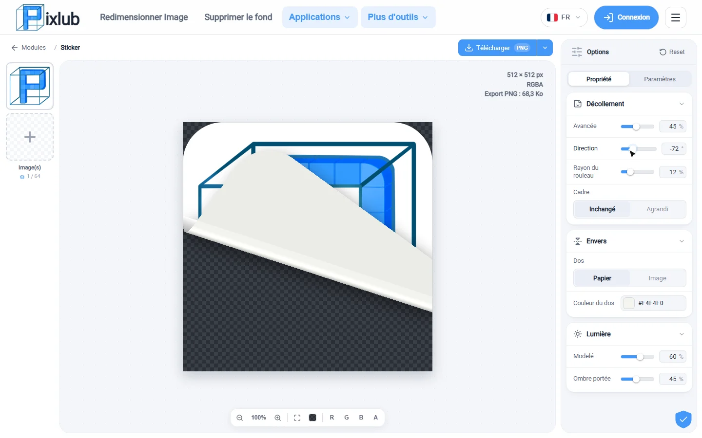

# Sticker

Décoller une image comme un autocollant, en l'enroulant dans une direction choisie.

**Catégorie** : Transformation · **Identifiant** : `sticker` · [Référence API](./api.md)

## Où l'utiliser

- **[Page du module](https://pixlub.com/fr/module/sticker)** : Déposez vos fichiers, réglez, téléchargez : le module seul, sans rien d'autre.
- **[Graphe d'image](https://pixlub.com/fr/image/graph)** : Reliez-le à d'autres modules pour composer un effet plus complexe.

## Entrées

Les fichiers que la page du module accepte : déposez-les sur la zone d’import, ou cliquez dessus pour parcourir. Un fichier d’un autre format est écarté, avec un message qui rappelle les formats permis.

| Entrée | Formats acceptés | Fichiers |
| --- | --- | --- |
| **Image(s)** (obligatoire) Image décollée comme un sticker ; sa transparence donne la forme du sticker. | `PNG`, `JPEG`, `WebP`, `GIF`, `AVIF`, `BMP` | Un ou plusieurs : chaque image est traitée à part, avec les mêmes réglages |

Le nombre d’images traitées d’un coup dépend de votre offre.

Par l’API, les fichiers et leurs formats sont détaillés dans la [vue API](./api.md).

## Présentation vidéo

▶ [Voir la vidéo](../../../../assets/modules/sticker/demo.fr.mp4) : Avancée, direction, rouleau, dos et lumière.

1. `0:00` Importer une image transparente
2. `0:02` Avancée et direction
3. `0:09` Rayon du rouleau
4. `0:13` Dos du sticker
5. `0:18` Modelé et ombre
6. `0:26` Exporter le résultat

## Utilisation

1. **Importer**

   Déposez une image. Sa transparence donne la forme du sticker : un logo détouré marche très bien.

2. **Décoller**

   Réglez l'**avancée** du pli et sa **direction**.

3. **Finir**

   Choisissez le **dos** (papier ou image) et dosez la **lumière**.

## Réglages

| Réglage | Effet |
| --- | --- |
| **Avancée** | 0 % : collé, 100 % : entièrement retourné. |
| **Direction** | Sens dans lequel le pli avance (−180° à 180°). |
| **Rayon du rouleau** | Rondeur de la partie qui s'enroule. |
| **Cadre** | **Agrandi** élargit l'image pour montrer le sticker retourné en entier. |
| **Dos** | **Papier** (couleur unie) ou **Image** (vue par transparence, en miroir). |
| **Modelé** / **Ombre portée** | Relief du rouleau et ombre sur le fond. |

## Astuces

- Exportez en PNG ou WebP pour garder la transparence autour du sticker.
- Pour un effet de coin qui se décolle, gardez une **avancée** faible (10 à 25 %).

## Exportation

Le bouton **Télécharger** enregistre le résultat dans le format du fichier importé : une photo JPEG ressort en JPEG. Le menu à sa droite ouvre les **Paramètres d’export** pour choisir un autre format, régler la qualité, la taille ou le fond, et propose **Copier l’image**.

Avec plusieurs images, le bouton devient **Téléchargement ZIP** ; le menu propose aussi les fichiers séparés, ou la seule image affichée.

- **[La modale d’exportation](../../../../01-app/fr/02-image/04-exportation.md)** : Tous les formats, leurs réglages, le traitement local ou serveur, les lots et le dossier local.
