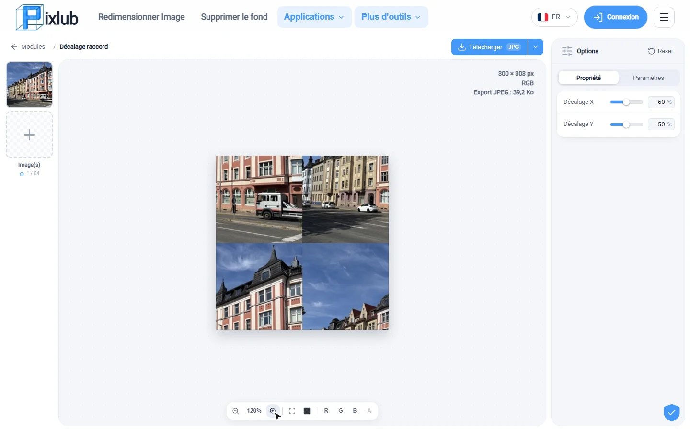

# Décalage raccord

Décaler une image en boucle pour vérifier et fabriquer des textures raccordables.

**Catégorie** : Transformation · **Identifiant** : `tile` · [Référence API](./api.md)

## Où l'utiliser

- **[Page du module](https://pixlub.com/fr/module/tile)** : Déposez vos fichiers, réglez, téléchargez : le module seul, sans rien d'autre.
- **[Graphe d'image](https://pixlub.com/fr/image/graph)** : Reliez-le à d'autres modules pour composer un effet plus complexe.

## Entrées

Les fichiers que la page du module accepte : déposez-les sur la zone d’import, ou cliquez dessus pour parcourir. Un fichier d’un autre format est écarté, avec un message qui rappelle les formats permis.

| Entrée | Formats acceptés | Fichiers |
| --- | --- | --- |
| **Image(s)** (obligatoire) Image qui va se décaler. | `PNG`, `JPEG`, `WebP`, `GIF`, `AVIF`, `BMP` | Un ou plusieurs : chaque image est traitée à part, avec les mêmes réglages |

Le nombre d’images traitées d’un coup dépend de votre offre.

Par l’API, les fichiers et leurs formats sont détaillés dans la [vue API](./api.md).

## Présentation vidéo

▶ [Voir la vidéo](../../../../assets/modules/tile/demo.fr.mp4) : Les raccords ramenés au centre, puis un décalage réglé.

1. `0:00` Importer une image
2. `0:02` Les raccords au centre
3. `0:07` Régler le décalage
4. `0:14` Exporter le résultat

## Utilisation

1. **Importer**

   Déposez la texture à vérifier.

2. **Regarder le centre**

   À 50 %, les bords de l'image se rejoignent au milieu : une couture visible signale une texture qui ne raccorde pas.

3. **Corriger**

   Retouchez la couture ailleurs, puis réglez le décalage pour revenir à l'image d'origine.

## Réglages

| Réglage | Effet |
| --- | --- |
| **Décalage X** | 0 à 100 % de la largeur. Ce qui sort à droite revient à gauche. |
| **Décalage Y** | 0 à 100 % de la hauteur. Ce qui sort en bas revient en haut. |

## Astuces

- 0 % ou 100 % redonnent l'image d'origine.
- Pour un décalage qui ne boucle pas, utilisez [Déplacement](../translate/README.md).

## Exportation

Le bouton **Télécharger** enregistre le résultat dans le format du fichier importé : une photo JPEG ressort en JPEG. Le menu à sa droite ouvre les **Paramètres d’export** pour choisir un autre format, régler la qualité, la taille ou le fond, et propose **Copier l’image**.

Avec plusieurs images, le bouton devient **Téléchargement ZIP** ; le menu propose aussi les fichiers séparés, ou la seule image affichée.

- **[La modale d’exportation](../../../../01-app/fr/02-image/04-exportation.md)** : Tous les formats, leurs réglages, le traitement local ou serveur, les lots et le dossier local.
