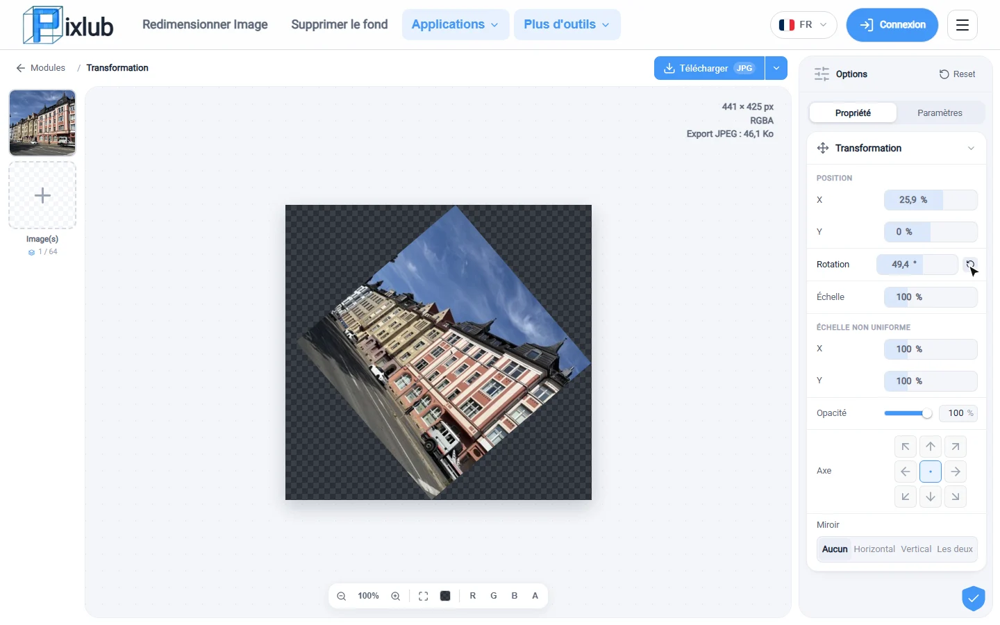

# Transformation

Déplacer, tourner, mettre à l'échelle, retourner et estomper une image en une fois.

**Catégorie** : Transformation · **Identifiant** : `transform` · [Référence API](./api.md)

## Où l'utiliser

- **[Page du module](https://pixlub.com/fr/module/transform)** : Déposez vos fichiers, réglez, téléchargez : le module seul, sans rien d'autre.
- **[Graphe d'image](https://pixlub.com/fr/image/graph)** : Reliez-le à d'autres modules pour composer un effet plus complexe.

## Entrées

Les fichiers que la page du module accepte : déposez-les sur la zone d’import, ou cliquez dessus pour parcourir. Un fichier d’un autre format est écarté, avec un message qui rappelle les formats permis.

| Entrée | Formats acceptés | Fichiers |
| --- | --- | --- |
| **Image(s)** (obligatoire) Image transformée. | `PNG`, `JPEG`, `WebP`, `GIF`, `AVIF`, `BMP` | Un ou plusieurs : chaque image est traitée à part, avec les mêmes réglages |

Le nombre d’images traitées d’un coup dépend de votre offre.

Par l’API, les fichiers et leurs formats sont détaillés dans la [vue API](./api.md).

## Présentation vidéo

▶ [Voir la vidéo](../../../../assets/modules/transform/demo.fr.mp4) : Position, rotation, échelle, opacité, miroir et axe.

1. `0:00` Importer une image
2. `0:02` Position et rotation
3. `0:08` Échelle
4. `0:14` Opacité et miroir
5. `0:20` Axe de la transformation
6. `0:25` Exporter le résultat

## Utilisation

1. **Importer**

   Déposez une ou plusieurs images.

2. **Régler**

   Sur l'aperçu, glissez l'image pour la déplacer, tirez un coin pour l'échelle et le point du haut pour pivoter ; ou réglez chaque volet (Position, Échelle, Rotation…).

3. **Choisir l'axe**

   L'**axe** est le point autour duquel l'image tourne, grandit et se retourne.

## Réglages

| Réglage | Effet |
| --- | --- |
| **X** / **Y** | Décalage, en % de la largeur et de la hauteur. |
| **Rotation** | −360° à 360°, autour de l'axe. |
| **Échelle** | 0 à 400 %, sur les deux axes. |
| **Échelle non uniforme X** / **Y** | Étire en largeur ou en hauteur, en plus de l'échelle. |
| **Opacité** | 0 à 100 %. |
| **Axe** | Centre, coin ou bord de référence. |
| **Miroir** | Aucun, horizontal, vertical ou les deux. |

L'image garde sa taille : ce qui sort est coupé, la place libérée est **transparente**.

## Astuces

- Dans le [graphe d'image](../../../../01-app/fr/02-image/01-image-graph.md), placez Transformation avant une fusion pour poser un calque où vous voulez.
- Pour seulement tourner l'image entière sans la couper, préférez [Rotation](../rotate/README.md).

## Exportation

Le bouton **Télécharger** enregistre le résultat dans le format du fichier importé : une photo JPEG ressort en JPEG. Le menu à sa droite ouvre les **Paramètres d’export** pour choisir un autre format, régler la qualité, la taille ou le fond, et propose **Copier l’image**.

Avec plusieurs images, le bouton devient **Téléchargement ZIP** ; le menu propose aussi les fichiers séparés, ou la seule image affichée.

- **[La modale d’exportation](../../../../01-app/fr/02-image/04-exportation.md)** : Tous les formats, leurs réglages, le traitement local ou serveur, les lots et le dossier local.
