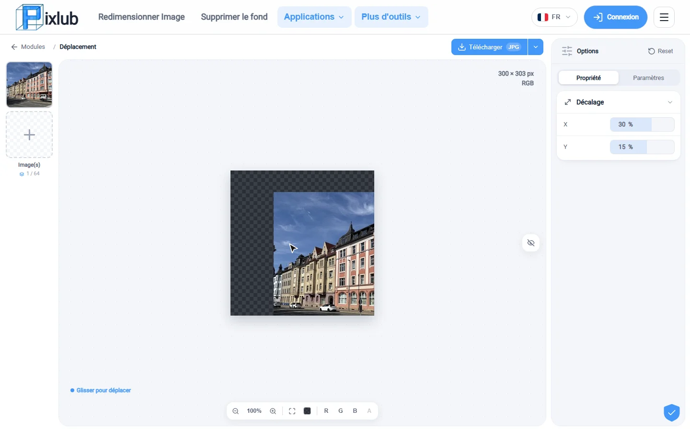

# Déplacement

Décaler le contenu d'une image en X et en Y, sans changer sa taille.

**Catégorie** : Transformation · **Identifiant** : `translate` · [Référence API](./api.md)

## Où l'utiliser

- **[Page du module](https://pixlub.com/fr/module/translate)** : Déposez vos fichiers, réglez, téléchargez : le module seul, sans rien d'autre.
- **[Graphe d'image](https://pixlub.com/fr/image/graph)** : Reliez-le à d'autres modules pour composer un effet plus complexe.

## Entrées

Les fichiers que la page du module accepte : déposez-les sur la zone d’import, ou cliquez dessus pour parcourir. Un fichier d’un autre format est écarté, avec un message qui rappelle les formats permis.

| Entrée | Formats acceptés | Fichiers |
| --- | --- | --- |
| **Image(s)** (obligatoire) Image dont la texture est déplacée. | `PNG`, `JPEG`, `WebP`, `GIF`, `AVIF`, `BMP` | Un ou plusieurs : chaque image est traitée à part, avec les mêmes réglages |

Le nombre d’images traitées d’un coup dépend de votre offre.

Par l’API, les fichiers et leurs formats sont détaillés dans la [vue API](./api.md).

## Présentation vidéo

▶ [Voir la vidéo](../../../../assets/modules/translate/demo.fr.mp4) : Glisser l'image, puis un décalage précis.

1. `0:00` Importer une image
2. `0:02` Glisser l’image
3. `0:06` Décalage précis
4. `0:12` Exporter le résultat

## Utilisation

1. **Importer**

   Déposez une ou plusieurs images.

2. **Déplacer**

   Glissez l'image dans l'aperçu, ou saisissez **X** et **Y**.

## Réglages

| Réglage | Effet |
| --- | --- |
| **X** | −100 à 100 % de la largeur. Positif : vers la droite. |
| **Y** | −100 à 100 % de la hauteur. Positif : vers le bas. |

L'image garde sa taille : ce qui sort est coupé, la place libérée est **transparente**.

## Astuces

- Pour que le bord qui sort revienne de l'autre côté (texture raccordable), utilisez [Décalage raccord](../tile/README.md).
- Pour déplacer, tourner et mettre à l'échelle en une fois : [Transformation](../transform/README.md).

## Exportation

Le bouton **Télécharger** enregistre le résultat dans le format du fichier importé : une photo JPEG ressort en JPEG. Le menu à sa droite ouvre les **Paramètres d’export** pour choisir un autre format, régler la qualité, la taille ou le fond, et propose **Copier l’image**.

Avec plusieurs images, le bouton devient **Téléchargement ZIP** ; le menu propose aussi les fichiers séparés, ou la seule image affichée.

- **[La modale d’exportation](../../../../01-app/fr/02-image/04-exportation.md)** : Tous les formats, leurs réglages, le traitement local ou serveur, les lots et le dossier local.
