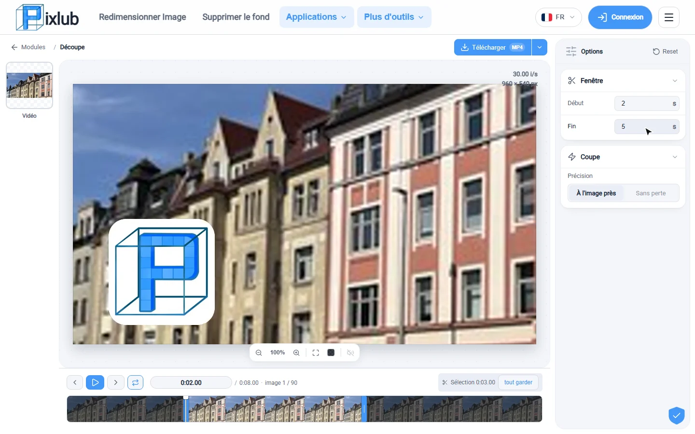

# Découpe

Garder un passage d'une vidéo, entre un début et une fin.

**Catégorie** : Transformation · **Identifiant** : `trimVideo`

## Où l'utiliser

- **[Page du module](https://pixlub.com/fr/module/trimVideo)** : Déposez vos fichiers, réglez, téléchargez : le module seul, sans rien d'autre.
- **[Éditeur vidéo](https://pixlub.com/fr/video/editor)** : Posez-le en effet sur un plan du montage.

## Entrées

Les fichiers que la page du module accepte : déposez-les sur la zone d’import, ou cliquez dessus pour parcourir. Un fichier d’un autre format est écarté, avec un message qui rappelle les formats permis.

| Entrée | Formats acceptés | Fichiers |
| --- | --- | --- |
| **Vidéo** (obligatoire) Vidéo dont une portion est gardée. | `MP4`, `WebM`, `MOV`, `MKV` | Un fichier |

## Présentation vidéo

▶ [Voir la vidéo](../../../../assets/modules/trimVideo/demo.fr.mp4) : Début et fin, lecture du passage, précision de la coupe.

1. `0:00` Importer une vidéo
2. `0:05` Début et fin du passage
3. `0:10` Lire le passage gardé
4. `0:16` Précision de la coupe
5. `0:19` Exporter le résultat

## Utilisation

1. **Importer**

   Déposez une vidéo.

2. **Donner le début et la fin**

   En secondes. Lisez l'aperçu pour vérifier le passage gardé.

3. **Choisir la précision**

   **À l'image près** coupe exactement, **Sans perte** va plus vite.

## Réglages

| Réglage | Effet |
| --- | --- |
| **Début** | Temps de départ, en secondes. |
| **Fin** | Temps de fin, en secondes. **0** garde jusqu'à la fin. |
| **Précision** | **À l'image près** : réencode la vidéo. **Sans perte** : la recopie telle quelle, début calé sur l'image clé la plus proche. |

Tout se fait dans le navigateur : la vidéo n'est pas envoyée.

## Astuces

- **Sans perte** garde la qualité d'origine et exporte en quelques secondes, mais le début peut avancer d'une fraction de seconde.
- Pour changer le rythme du passage gardé : [Vitesse](../speedVideo/README.md).

## Exportation

Le résultat s’exporte depuis la page du module ou l’éditeur vidéo, en MP4, WebM ou un autre conteneur vidéo, sans quitter votre navigateur.

- **[L’éditeur vidéo](../../../../01-app/fr/03-video/01-video-editor.md)** : Monter, régler les effets et exporter une vidéo.
