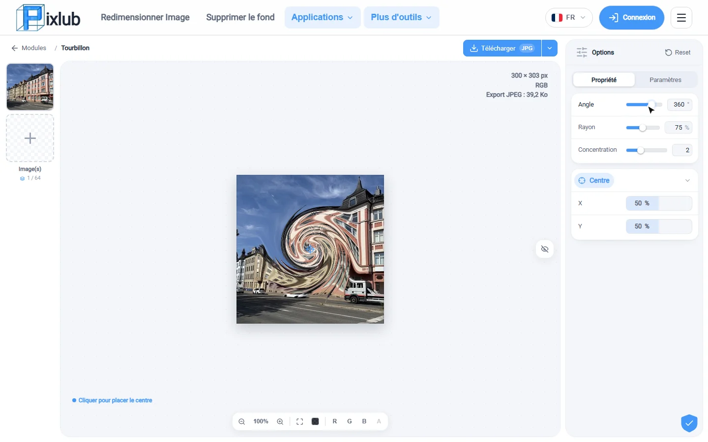

# Tourbillon

Tordre une image en spirale autour d'un centre.

**Catégorie** : Transformation · **Identifiant** : `twirl` · [Référence API](./api.md)

## Où l'utiliser

- **[Page du module](https://pixlub.com/fr/module/twirl)** : Déposez vos fichiers, réglez, téléchargez : le module seul, sans rien d'autre.
- **[Graphe d'image](https://pixlub.com/fr/image/graph)** : Reliez-le à d'autres modules pour composer un effet plus complexe.

## Entrées

Les fichiers que la page du module accepte : déposez-les sur la zone d’import, ou cliquez dessus pour parcourir. Un fichier d’un autre format est écarté, avec un message qui rappelle les formats permis.

| Entrée | Formats acceptés | Fichiers |
| --- | --- | --- |
| **Image(s)** (obligatoire) Image tordue en spirale. | `PNG`, `JPEG`, `WebP`, `GIF`, `AVIF`, `BMP` | Un ou plusieurs : chaque image est traitée à part, avec les mêmes réglages |

Le nombre d’images traitées d’un coup dépend de votre offre.

Par l’API, les fichiers et leurs formats sont détaillés dans la [vue API](./api.md).

## Présentation vidéo

▶ [Voir la vidéo](../../../../assets/modules/twirl/demo.fr.mp4) : Angle, rayon, concentration et centre.

1. `0:00` Importer une image
2. `0:03` Angle du tourbillon
3. `0:06` Rayon et concentration
4. `0:13` Placer le centre
5. `0:15` Exporter le résultat

## Utilisation

1. **Importer**

   Déposez une ou plusieurs images.

2. **Tordre**

   L'**angle** fixe le nombre de tours, le **rayon** la taille du tourbillon.

3. **Placer le centre**

   Cliquez dans l'aperçu.

## Réglages

| Réglage | Effet |
| --- | --- |
| **Angle** | −720° à 720°. Le signe choisit le sens. |
| **Rayon** | 1 à 150 % : zone touchée autour du centre. |
| **Concentration** | 1 à 4. Haute : la torsion se resserre au centre. |
| **Centre X** / **Y** | Position du centre, en %. |

## Astuces

- Un petit angle (30° à 90°) suffit pour un effet d'eau qui tourne.
- Pour un effet de loupe plutôt que de spirale : [Distorsion de lentille](../fisheye/README.md).

## Exportation

Le bouton **Télécharger** enregistre le résultat dans le format du fichier importé : une photo JPEG ressort en JPEG. Le menu à sa droite ouvre les **Paramètres d’export** pour choisir un autre format, régler la qualité, la taille ou le fond, et propose **Copier l’image**.

Avec plusieurs images, le bouton devient **Téléchargement ZIP** ; le menu propose aussi les fichiers séparés, ou la seule image affichée.

- **[La modale d’exportation](../../../../01-app/fr/02-image/04-exportation.md)** : Tous les formats, leurs réglages, le traitement local ou serveur, les lots et le dossier local.
