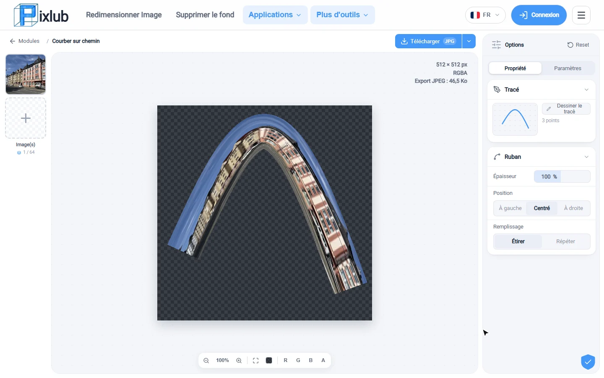

# Courber sur chemin

Courber une image le long d'un tracé, comme un ruban.

**Catégorie** : Transformation · **Identifiant** : `warpPath` · [Référence API](./api.md)

## Où l'utiliser

- **[Page du module](https://pixlub.com/fr/module/warpPath)** : Déposez vos fichiers, réglez, téléchargez : le module seul, sans rien d'autre.
- **[Graphe d'image](https://pixlub.com/fr/image/graph)** : Reliez-le à d'autres modules pour composer un effet plus complexe.

## Entrées

Les fichiers que la page du module accepte : déposez-les sur la zone d’import, ou cliquez dessus pour parcourir. Un fichier d’un autre format est écarté, avec un message qui rappelle les formats permis.

| Entrée | Formats acceptés | Fichiers |
| --- | --- | --- |
| **Image** (obligatoire) Image courbée le long du chemin : sa largeur suit le tracé, sa hauteur devient l'épaisseur du ruban. | `PNG`, `JPEG`, `WebP`, `GIF`, `AVIF`, `BMP` | Un fichier |

Par l’API, les fichiers et leurs formats sont détaillés dans la [vue API](./api.md).

## Présentation vidéo

▶ [Voir la vidéo](../../../../assets/modules/warpPath/demo.fr.mp4) : Redessiner le tracé, régler l'épaisseur, la position et le remplissage.

1. `0:00` Importer une image
2. `0:03` Redessiner le tracé
3. `0:19` Épaisseur du ruban
4. `0:23` Position et remplissage
5. `0:28` Exporter le résultat

## Utilisation

1. **Importer**

   Déposez une image : sa largeur suit le tracé, sa hauteur devient l'épaisseur du ruban.

2. **Dessiner le tracé**

   **Dessiner le tracé** ouvre l'éditeur : cliquez pour ajouter un point, glissez-le pour le déplacer, double-cliquez pour le retirer, puis **Valider**.

3. **Régler le ruban**

   Épaisseur, position et remplissage dans le panneau.

## Réglages

| Réglage | Effet |
| --- | --- |
| **Tracé** | Les points du chemin, avec lissage et arrondi des angles. |
| **Épaisseur** | 10 à 200 %. À 100 %, l'image garde ses proportions. |
| **Position** | Ruban **à gauche**, **centré** ou **à droite** du tracé. |
| **Remplissage** | **Étirer** une fois sur tout le tracé, ou **Répéter** l'image. |

Le résultat a la taille du cadre du tracé ; le reste est **transparent**.

## Astuces

- Une épaisseur trop forte se resserre dans les virages serrés : adoucissez la courbe ou baissez l'épaisseur.
- **Répéter** convient aux motifs (frise, ruban décoratif), **Étirer** à un texte ou une photo.

## Exportation

Le bouton **Télécharger** enregistre le résultat dans le format du fichier importé : une photo JPEG ressort en JPEG. Le menu à sa droite ouvre les **Paramètres d’export** pour choisir un autre format, régler la qualité, la taille ou le fond, et propose **Copier l’image**.

- **[La modale d’exportation](../../../../01-app/fr/02-image/04-exportation.md)** : Tous les formats, leurs réglages, le traitement local ou serveur, les lots et le dossier local.
