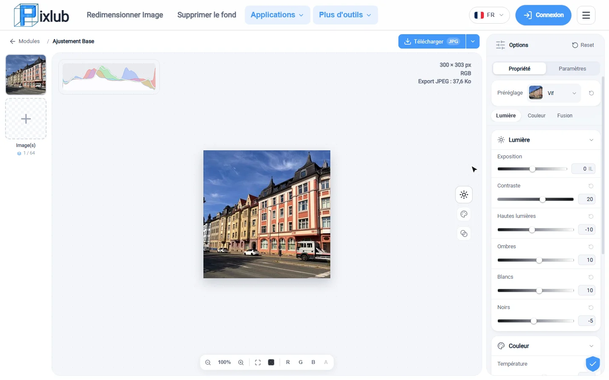

# Ajustement Base

Les réglages essentiels d'une photo réunis : lumière, tons, balance des blancs et couleurs.

**Catégorie** : Ajustement · **Identifiant** : `baseAdjust` · [Référence API](./api.md)

## Où l'utiliser

- **[Page du module](https://pixlub.com/fr/module/baseAdjust)** : Déposez vos fichiers, réglez, téléchargez : le module seul, sans rien d'autre.
- **[Graphe d'image](https://pixlub.com/fr/image/graph)** : Reliez-le à d'autres modules pour composer un effet plus complexe.

## Entrées

Les fichiers que la page du module accepte : déposez-les sur la zone d’import, ou cliquez dessus pour parcourir. Un fichier d’un autre format est écarté, avec un message qui rappelle les formats permis.

| Entrée | Formats acceptés | Fichiers |
| --- | --- | --- |
| **Image(s)** (obligatoire) Image à développer. | `PNG`, `JPEG`, `WebP`, `GIF`, `AVIF`, `BMP` | Un ou plusieurs : chaque image est traitée à part, avec les mêmes réglages |

Le nombre d’images traitées d’un coup dépend de votre offre.

Par l’API, les fichiers et leurs formats sont détaillés dans la [vue API](./api.md).

## Présentation vidéo

▶ [Voir la vidéo](../../../../assets/modules/baseAdjust/demo.fr.mp4) : Préréglage, lumière, couleur.

1. `0:00` Importer une image
2. `0:02` Partir d’un préréglage
3. `0:10` Lumière
4. `0:20` Couleur
5. `0:27` Exporter le résultat

## Utilisation

1. **Importer**

   Déposez une ou plusieurs images.

2. **Partir d'un préréglage**

   Choisissez un **préréglage** en haut du panneau, ou restez en **Personnalisé**.

3. **Affiner**

   Les onglets **Lumière**, **Couleur** et **Fusion** mènent à chaque groupe de glissières.

## Réglages

| Réglage | Effet |
| --- | --- |
| **Exposition** | −5 à 5 IL. +1 double la lumière, −1 la divise par deux. |
| **Contraste** | Écarte ou rapproche les tons clairs et sombres. |
| **Hautes lumières** / **Ombres** | Assombrit les tons clairs (un ciel), débouche les tons sombres. |
| **Blancs** / **Noirs** | Déplace les points blanc et noir. |
| **Température** / **Teinte** | Bleu ↔ jaune orangé, vert ↔ magenta. |
| **Vibrance** / **Saturation** | Ravive surtout les couleurs ternes / toutes les couleurs (−100 : gris). |
| **Décalage de teinte** | −180° à 180° sur le cercle des couleurs. |
| **Fusion** | Méthode de fusion et opacité : comment le réglage se pose sur l'image d'origine. |

## Astuces

- Pour une photo terne, préférez la **vibrance** à la saturation : les couleurs déjà vives ne saturent pas.
- Pour empiler plusieurs réglages, utilisez l'[éditeur de réglages](../../../../01-app/fr/02-image/03-image-adjust.md).

## Exportation

Le bouton **Télécharger** enregistre le résultat dans le format du fichier importé : une photo JPEG ressort en JPEG. Le menu à sa droite ouvre les **Paramètres d’export** pour choisir un autre format, régler la qualité, la taille ou le fond, et propose **Copier l’image**.

Avec plusieurs images, le bouton devient **Téléchargement ZIP** ; le menu propose aussi les fichiers séparés, ou la seule image affichée.

- **[La modale d’exportation](../../../../01-app/fr/02-image/04-exportation.md)** : Tous les formats, leurs réglages, le traitement local ou serveur, les lots et le dossier local.
