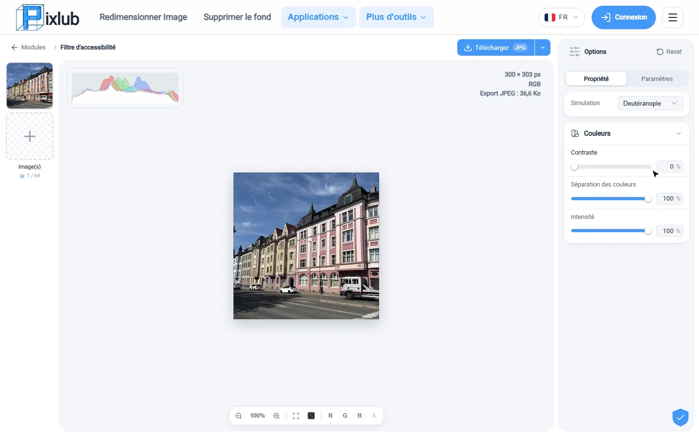

# Filtre d'accessibilité

Corriger les couleurs d'une image pour qu'elles restent lisibles par une vision daltonienne.

**Catégorie** : Ajustement · **Identifiant** : `colorAccessibility` · [Référence API](./api.md)

## Où l'utiliser

- **[Page du module](https://pixlub.com/fr/module/colorAccessibility)** : Déposez vos fichiers, réglez, téléchargez : le module seul, sans rien d'autre.
- **[Graphe d'image](https://pixlub.com/fr/image/graph)** : Reliez-le à d'autres modules pour composer un effet plus complexe.

## Entrées

Les fichiers que la page du module accepte : déposez-les sur la zone d’import, ou cliquez dessus pour parcourir. Un fichier d’un autre format est écarté, avec un message qui rappelle les formats permis.

| Entrée | Formats acceptés | Fichiers |
| --- | --- | --- |
| **Image(s)** (obligatoire) Image dont les couleurs sont corrigées pour une vision daltonienne. | `PNG`, `JPEG`, `WebP`, `GIF`, `AVIF`, `BMP` | Un ou plusieurs : chaque image est traitée à part, avec les mêmes réglages |

Le nombre d’images traitées d’un coup dépend de votre offre.

Par l’API, les fichiers et leurs formats sont détaillés dans la [vue API](./api.md).

## Présentation vidéo

▶ [Voir la vidéo](../../../../assets/modules/colorAccessibility/demo.fr.mp4) : Choisir la vision, doser la correction.

1. `0:00` Importer une image
2. `0:02` Choisir la vision
3. `0:06` Doser la correction
4. `0:13` Exporter le résultat

## Utilisation

1. **Importer**

   Déposez une ou plusieurs images.

2. **Choisir la vision**

   Protanopie, deutéranopie, tritanopie ou leurs formes atténuées.

3. **Doser**

   Contraste, séparation des couleurs et intensité de la correction.

## Réglages

| Réglage | Effet |
| --- | --- |
| **Simulation** | Vision pour laquelle l'image est corrigée. **Normal** ne change rien. |
| **Contraste** | Écarte les couleurs autour du gris moyen. |
| **Séparation des couleurs** | Reporte les nuances perdues sur les couleurs encore perçues. |
| **Intensité** | Dosage de la correction. |

## Astuces

- Utile pour un graphique ou une carte dont les couleurs portent une information.
- La deutéranomalie (vert mal perçu) est la forme la plus courante.

## Exportation

Le bouton **Télécharger** enregistre le résultat dans le format du fichier importé : une photo JPEG ressort en JPEG. Le menu à sa droite ouvre les **Paramètres d’export** pour choisir un autre format, régler la qualité, la taille ou le fond, et propose **Copier l’image**.

Avec plusieurs images, le bouton devient **Téléchargement ZIP** ; le menu propose aussi les fichiers séparés, ou la seule image affichée.

- **[La modale d’exportation](../../../../01-app/fr/02-image/04-exportation.md)** : Tous les formats, leurs réglages, le traitement local ou serveur, les lots et le dossier local.
