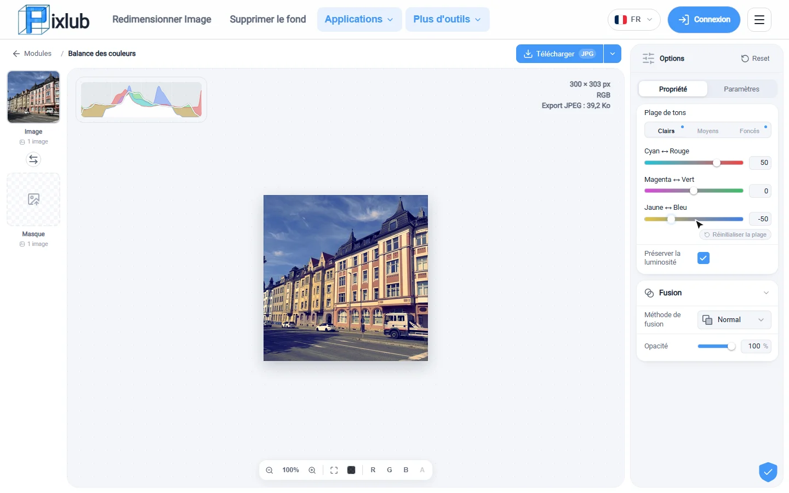

# Balance des couleurs

Teinter séparément les tons clairs, moyens et foncés d'une image.

**Catégorie** : Ajustement · **Identifiant** : `colorBalance` · [Référence API](./api.md)

## Où l'utiliser

- **[Page du module](https://pixlub.com/fr/module/colorBalance)** : Déposez vos fichiers, réglez, téléchargez : le module seul, sans rien d'autre.
- **[Graphe d'image](https://pixlub.com/fr/image/graph)** : Reliez-le à d'autres modules pour composer un effet plus complexe.

## Entrées

Les fichiers que la page du module accepte : déposez-les sur la zone d’import, ou cliquez dessus pour parcourir. Un fichier d’un autre format est écarté, avec un message qui rappelle les formats permis.

| Entrée | Formats acceptés | Fichiers |
| --- | --- | --- |
| **Image** (obligatoire) Image dont les teintes sont ajustées. | `PNG`, `JPEG`, `WebP`, `GIF`, `AVIF`, `BMP` | Un fichier |
| **Masque** (facultative) Masque facultatif : le réglage suit sa clarté, blanc = plein effet, noir = aucun. Absent, toute l'image est réglée. | `PNG`, `JPEG`, `WebP`, `GIF`, `AVIF`, `BMP` | Un fichier |

Par l’API, les fichiers et leurs formats sont détaillés dans la [vue API](./api.md).

## Présentation vidéo

▶ [Voir la vidéo](../../../../assets/modules/colorBalance/demo.fr.mp4) : Tons foncés, tons clairs, luminosité préservée.

1. `0:00` Importer une image
2. `0:02` Tons foncés
3. `0:07` Tons clairs
4. `0:16` Préserver la luminosité
5. `0:19` Exporter le résultat

## Utilisation

1. **Importer**

   Déposez une ou plusieurs images.

2. **Choisir la plage**

   Les onglets **Clairs**, **Moyens** et **Foncés** choisissent les tons réglés.

3. **Teinter**

   Trois glissières : cyan ↔ rouge, magenta ↔ vert, jaune ↔ bleu.

## Réglages

| Réglage | Effet |
| --- | --- |
| **Plage de tons** | Clairs, moyens ou foncés, chacun avec ses trois glissières. |
| **Préserver la luminosité** | Seule la teinte change, jamais la clarté de l'image. |
| **Fusion** | Méthode de fusion et opacité : comment le réglage se pose sur l'image d'origine. |

## Astuces

- Ombres vers le bleu, lumières vers l'orange : l'étalonnage « teal & orange » des films.
- Dans le [graphe d'image](../../../../01-app/fr/02-image/01-image-graph.md), un masque limite le réglage à une zone.

## Exportation

Le bouton **Télécharger** enregistre le résultat dans le format du fichier importé : une photo JPEG ressort en JPEG. Le menu à sa droite ouvre les **Paramètres d’export** pour choisir un autre format, régler la qualité, la taille ou le fond, et propose **Copier l’image**.

- **[La modale d’exportation](../../../../01-app/fr/02-image/04-exportation.md)** : Tous les formats, leurs réglages, le traitement local ou serveur, les lots et le dossier local.
