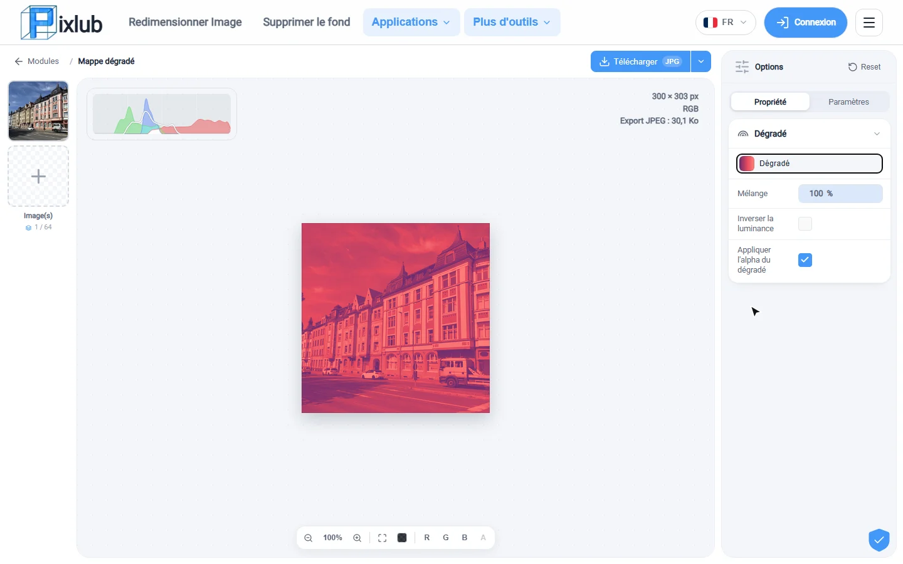

# Mappe dégradé

Recolorer une image en remplaçant sa clarté par les couleurs d'un dégradé.

**Catégorie** : Ajustement · **Identifiant** : `gradientMap` · [Référence API](./api.md)

## Où l'utiliser

- **[Page du module](https://pixlub.com/fr/module/gradientMap)** : Déposez vos fichiers, réglez, téléchargez : le module seul, sans rien d'autre.
- **[Graphe d'image](https://pixlub.com/fr/image/graph)** : Reliez-le à d'autres modules pour composer un effet plus complexe.

## Entrées

Les fichiers que la page du module accepte : déposez-les sur la zone d’import, ou cliquez dessus pour parcourir. Un fichier d’un autre format est écarté, avec un message qui rappelle les formats permis.

| Entrée | Formats acceptés | Fichiers |
| --- | --- | --- |
| **Image(s)** (obligatoire) Image dont la luminance est colorisée par le dégradé. | `PNG`, `JPEG`, `WebP`, `GIF`, `AVIF`, `BMP` | Un ou plusieurs : chaque image est traitée à part, avec les mêmes réglages |

Le nombre d’images traitées d’un coup dépend de votre offre.

Par l’API, les fichiers et leurs formats sont détaillés dans la [vue API](./api.md).

## Présentation vidéo

▶ [Voir la vidéo](../../../../assets/modules/gradientMap/demo.fr.mp4) : Choisir un dégradé, le mélanger, l'inverser.

1. `0:00` Importer une image
2. `0:03` Choisir un dégradé
3. `0:09` Mélange et inversion
4. `0:16` Exporter le résultat

## Utilisation

1. **Importer**

   Déposez une ou plusieurs images.

2. **Choisir le dégradé**

   Ouvrez le champ **Dégradé** : prenez-en un dans la collection, ou modifiez ses points.

3. **Doser**

   Le **mélange** garde une part de l'image d'origine.

## Réglages

| Réglage | Effet |
| --- | --- |
| **Dégradé** | Les noirs prennent la couleur de gauche, les blancs celle de droite. |
| **Mélange** | 0 à 100 % de l'effet. |
| **Inverser la luminance** | Les clairs prennent le début du dégradé. |
| **Appliquer l'alpha du dégradé** | Un point transparent du dégradé rend transparents les tons correspondants. |

## Astuces

- Un dégradé de deux couleurs vives donne un effet duotone.
- Pour une seule couleur, [Recolorer](../recolor/README.md) est plus simple.

## Exportation

Le bouton **Télécharger** enregistre le résultat dans le format du fichier importé : une photo JPEG ressort en JPEG. Le menu à sa droite ouvre les **Paramètres d’export** pour choisir un autre format, régler la qualité, la taille ou le fond, et propose **Copier l’image**.

Avec plusieurs images, le bouton devient **Téléchargement ZIP** ; le menu propose aussi les fichiers séparés, ou la seule image affichée.

- **[La modale d’exportation](../../../../01-app/fr/02-image/04-exportation.md)** : Tous les formats, leurs réglages, le traitement local ou serveur, les lots et le dossier local.
