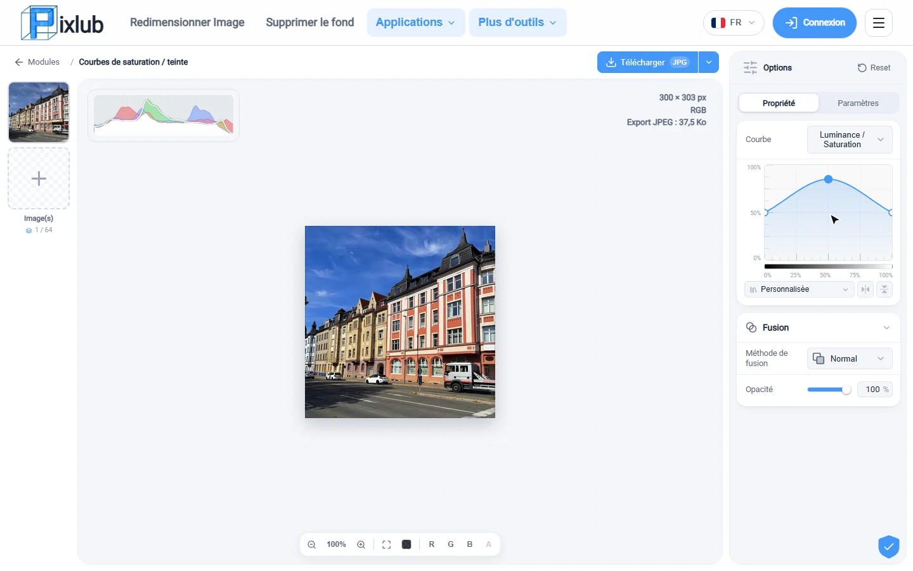

# Courbes de saturation / teinte

Régler la saturation ou la teinte de chaque couleur selon sa luminance, sa saturation ou sa teinte.

**Catégorie** : Ajustement · **Identifiant** : `hueSatCurves` · [Référence API](./api.md)

## Où l'utiliser

- **[Page du module](https://pixlub.com/fr/module/hueSatCurves)** : Déposez vos fichiers, réglez, téléchargez : le module seul, sans rien d'autre.
- **[Graphe d'image](https://pixlub.com/fr/image/graph)** : Reliez-le à d'autres modules pour composer un effet plus complexe.

## Entrées

Les fichiers que la page du module accepte : déposez-les sur la zone d’import, ou cliquez dessus pour parcourir. Un fichier d’un autre format est écarté, avec un message qui rappelle les formats permis.

| Entrée | Formats acceptés | Fichiers |
| --- | --- | --- |
| **Image(s)** (obligatoire) Image dont la teinte ou la saturation est réglée par les courbes. | `PNG`, `JPEG`, `WebP`, `GIF`, `AVIF`, `BMP` | Un ou plusieurs : chaque image est traitée à part, avec les mêmes réglages |

Le nombre d’images traitées d’un coup dépend de votre offre.

Par l’API, les fichiers et leurs formats sont détaillés dans la [vue API](./api.md).

## Présentation vidéo

▶ [Voir la vidéo](../../../../assets/modules/hueSatCurves/demo.fr.mp4) : Saturation selon la luminance, puis teinte selon la teinte.

1. `0:00` Importer une image
2. `0:02` Saturation selon la luminance
3. `0:05` Teinte selon la teinte
4. `0:13` Exporter le résultat

## Utilisation

1. **Importer**

   Déposez une ou plusieurs images.

2. **Choisir la courbe**

   Le menu **Courbe** affiche l'une des quatre ; toutes s'appliquent ensemble.

3. **La tirer**

   Courbe à mi-hauteur : aucun changement. Au-dessus la valeur monte, en dessous elle baisse.

## Réglages

| Réglage | Effet |
| --- | --- |
| **Luminance / Saturation** | Saturation selon la clarté : désaturer les ombres, par exemple. |
| **Saturation / Saturation** | Saturation selon la saturation : raviver les tons ternes. |
| **Teinte / Saturation** | Saturation selon la teinte : éteindre une seule couleur. |
| **Teinte / Teinte** | Teinte selon la teinte : déplacer une couleur vers une autre. |
| **Fusion** | Méthode de fusion et opacité : comment le réglage se pose sur l'image d'origine. |

## Astuces

- Baisser le début de **Luminance / Saturation** donne des ombres neutres, sans dominante.

## Exportation

Le bouton **Télécharger** enregistre le résultat dans le format du fichier importé : une photo JPEG ressort en JPEG. Le menu à sa droite ouvre les **Paramètres d’export** pour choisir un autre format, régler la qualité, la taille ou le fond, et propose **Copier l’image**.

Avec plusieurs images, le bouton devient **Téléchargement ZIP** ; le menu propose aussi les fichiers séparés, ou la seule image affichée.

- **[La modale d’exportation](../../../../01-app/fr/02-image/04-exportation.md)** : Tous les formats, leurs réglages, le traitement local ou serveur, les lots et le dossier local.
