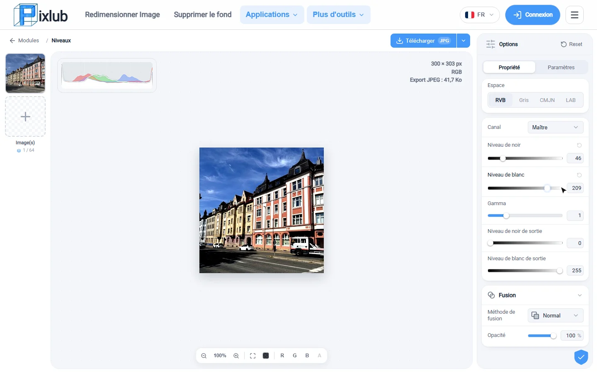

# Niveaux

Régler les points noir et blanc, le gamma et la plage de sortie, canal par canal.

**Catégorie** : Ajustement · **Identifiant** : `levels` · [Référence API](./api.md)

## Où l'utiliser

- **[Page du module](https://pixlub.com/fr/module/levels)** : Déposez vos fichiers, réglez, téléchargez : le module seul, sans rien d'autre.
- **[Graphe d'image](https://pixlub.com/fr/image/graph)** : Reliez-le à d'autres modules pour composer un effet plus complexe.

## Entrées

Les fichiers que la page du module accepte : déposez-les sur la zone d’import, ou cliquez dessus pour parcourir. Un fichier d’un autre format est écarté, avec un message qui rappelle les formats permis.

| Entrée | Formats acceptés | Fichiers |
| --- | --- | --- |
| **Image(s)** (obligatoire) Image dont les niveaux sont ajustés. | `PNG`, `JPEG`, `WebP`, `GIF`, `AVIF`, `BMP` | Un ou plusieurs : chaque image est traitée à part, avec les mêmes réglages |

Le nombre d’images traitées d’un coup dépend de votre offre.

Par l’API, les fichiers et leurs formats sont détaillés dans la [vue API](./api.md).

## Présentation vidéo

▶ [Voir la vidéo](../../../../assets/modules/levels/demo.fr.mp4) : Points noir et blanc, gamma, puis un canal seul.

1. `0:00` Importer une image
2. `0:02` Points noir et blanc
3. `0:09` Gamma des tons moyens
4. `0:13` Un canal à la fois
5. `0:20` Exporter le résultat

## Utilisation

1. **Importer**

   Déposez une ou plusieurs images.

2. **Caler noir et blanc**

   Montez le **niveau de noir**, descendez le **niveau de blanc** : le contraste s'ouvre.

3. **Affiner**

   Le **gamma** éclaircit ou assombrit les tons moyens. Le menu **Canal** règle une couleur à part.

## Réglages

| Réglage | Effet |
| --- | --- |
| **Espace** | RVB, Gris, CMJN ou LAB. |
| **Canal** | Maître (tous) ou un canal de l'espace. Tous les canaux s'appliquent ensemble. |
| **Niveau de noir** / **de blanc** | 0 à 255. Ce qui est plus sombre devient noir, plus clair devient blanc. |
| **Gamma** | 0,1 à 4. Sous 1 l'image s'assombrit, au-dessus elle s'éclaircit. |
| **Niveaux de sortie** | Valeurs que prennent le noir et le blanc : effet délavé ou terni. |
| **Fusion** | Méthode de fusion et opacité : comment le réglage se pose sur l'image d'origine. |

## Astuces

- Un canal **Bleu** ou **Rouge** réglé seul corrige une dominante de couleur.
- Monter le noir de sortie donne un rendu mat, façon film.

## Exportation

Le bouton **Télécharger** enregistre le résultat dans le format du fichier importé : une photo JPEG ressort en JPEG. Le menu à sa droite ouvre les **Paramètres d’export** pour choisir un autre format, régler la qualité, la taille ou le fond, et propose **Copier l’image**.

Avec plusieurs images, le bouton devient **Téléchargement ZIP** ; le menu propose aussi les fichiers séparés, ou la seule image affichée.

- **[La modale d’exportation](../../../../01-app/fr/02-image/04-exportation.md)** : Tous les formats, leurs réglages, le traitement local ou serveur, les lots et le dossier local.
