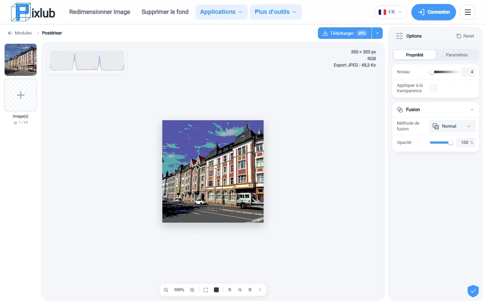

# Postériser

Réduire le nombre de nuances par canal pour des aplats stylisés.

**Catégorie** : Ajustement · **Identifiant** : `posterize` · [Référence API](./api.md)

## Où l'utiliser

- **[Page du module](https://pixlub.com/fr/module/posterize)** : Déposez vos fichiers, réglez, téléchargez : le module seul, sans rien d'autre.
- **[Graphe d'image](https://pixlub.com/fr/image/graph)** : Reliez-le à d'autres modules pour composer un effet plus complexe.

## Entrées

Les fichiers que la page du module accepte : déposez-les sur la zone d’import, ou cliquez dessus pour parcourir. Un fichier d’un autre format est écarté, avec un message qui rappelle les formats permis.

| Entrée | Formats acceptés | Fichiers |
| --- | --- | --- |
| **Image(s)** (obligatoire) Image dont les niveaux de chaque canal sont réduits. | `PNG`, `JPEG`, `WebP`, `GIF`, `AVIF`, `BMP` | Un ou plusieurs : chaque image est traitée à part, avec les mêmes réglages |

Le nombre d’images traitées d’un coup dépend de votre offre.

Par l’API, les fichiers et leurs formats sont détaillés dans la [vue API](./api.md).

## Présentation vidéo

▶ [Voir la vidéo](../../../../assets/modules/posterize/demo.fr.mp4) : 3 niveaux, puis 8, et l'opacité.

1. `0:00` Importer une image
2. `0:03` Nombre de niveaux
3. `0:09` Doser avec l’opacité
4. `0:16` Exporter le résultat

## Utilisation

1. **Importer**

   Déposez une ou plusieurs images.

2. **Choisir le nombre de niveaux**

   Peu de niveaux : des aplats francs. Beaucoup : l'image se rapproche de l'originale.

## Réglages

| Réglage | Effet |
| --- | --- |
| **Niveau** | 2 à 256 paliers par canal. |
| **Appliquer à la transparence** | Postérise aussi le canal alpha. |
| **Fusion** | Méthode de fusion et opacité : comment le réglage se pose sur l'image d'origine. |

## Astuces

- 4 à 6 niveaux donnent un effet affiche ou dessin animé.
- Combinez avec [Contour](../outline/README.md) pour un rendu façon BD.

## Exportation

Le bouton **Télécharger** enregistre le résultat dans le format du fichier importé : une photo JPEG ressort en JPEG. Le menu à sa droite ouvre les **Paramètres d’export** pour choisir un autre format, régler la qualité, la taille ou le fond, et propose **Copier l’image**.

Avec plusieurs images, le bouton devient **Téléchargement ZIP** ; le menu propose aussi les fichiers séparés, ou la seule image affichée.

- **[La modale d’exportation](../../../../01-app/fr/02-image/04-exportation.md)** : Tous les formats, leurs réglages, le traitement local ou serveur, les lots et le dossier local.
