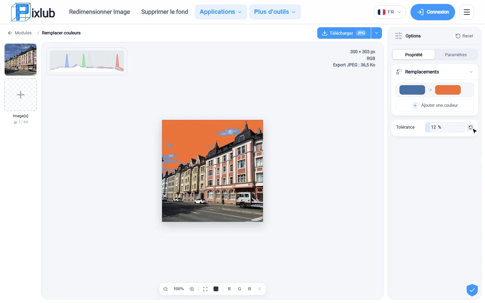

# Remplacer couleurs

Remplacer une ou plusieurs couleurs d'une image par d'autres.

**Catégorie** : Ajustement · **Identifiant** : `replaceColors` · [Référence API](./api.md)

## Où l'utiliser

- **[Page du module](https://pixlub.com/fr/module/replaceColors)** : Déposez vos fichiers, réglez, téléchargez : le module seul, sans rien d'autre.
- **[Graphe d'image](https://pixlub.com/fr/image/graph)** : Reliez-le à d'autres modules pour composer un effet plus complexe.

## Entrées

Les fichiers que la page du module accepte : déposez-les sur la zone d’import, ou cliquez dessus pour parcourir. Un fichier d’un autre format est écarté, avec un message qui rappelle les formats permis.

| Entrée | Formats acceptés | Fichiers |
| --- | --- | --- |
| **Image(s)** (obligatoire) Image dont les couleurs sources sont remplacées. | `PNG`, `JPEG`, `WebP`, `GIF`, `AVIF`, `BMP` | Un ou plusieurs : chaque image est traitée à part, avec les mêmes réglages |

Le nombre d’images traitées d’un coup dépend de votre offre.

Par l’API, les fichiers et leurs formats sont détaillés dans la [vue API](./api.md).

## Présentation vidéo

▶ [Voir la vidéo](../../../../assets/modules/replaceColors/demo.fr.mp4) : Une paire de couleurs, puis la tolérance.

1. `0:00` Importer une image
2. `0:02` Ajouter une paire de couleurs
3. `0:16` Élargir avec la tolérance
4. `0:20` Exporter le résultat

## Utilisation

1. **Importer**

   Déposez une ou plusieurs images.

2. **Ajouter une paire**

   **Ajouter une couleur**, puis choisissez la couleur à remplacer et la nouvelle (saisie HEX ou pipette).

3. **Régler la tolérance**

   Montez-la pour emporter les nuances proches.

## Réglages

| Réglage | Effet |
| --- | --- |
| **Couleurs** | Liste de paires : couleur à remplacer → nouvelle couleur. |
| **Tolérance** | 0 % : couleur exacte seulement. 100 % : toutes les couleurs. |

## Astuces

- Une tolérance de 20 à 40 % suffit pour un aplat de couleur avec ses légères variations.
- Pour changer une couleur en gardant ses nuances, [HSL](../hsl/README.md) est plus doux.

## Exportation

Le bouton **Télécharger** enregistre le résultat dans le format du fichier importé : une photo JPEG ressort en JPEG. Le menu à sa droite ouvre les **Paramètres d’export** pour choisir un autre format, régler la qualité, la taille ou le fond, et propose **Copier l’image**.

Avec plusieurs images, le bouton devient **Téléchargement ZIP** ; le menu propose aussi les fichiers séparés, ou la seule image affichée.

- **[La modale d’exportation](../../../../01-app/fr/02-image/04-exportation.md)** : Tous les formats, leurs réglages, le traitement local ou serveur, les lots et le dossier local.
