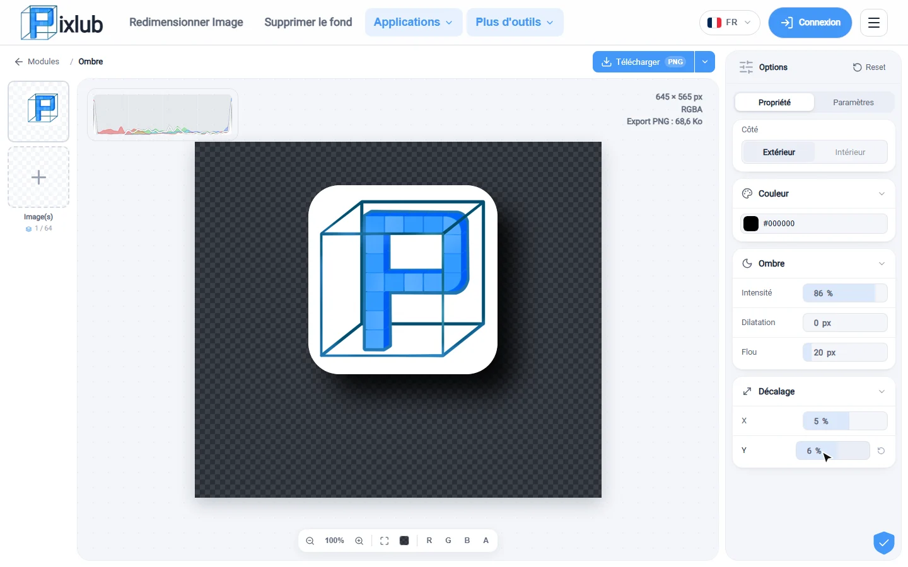

# Ombre

Projeter une ombre, extérieure ou intérieure, à partir de la silhouette d'une image.

**Catégorie** : Ajustement · **Identifiant** : `shadow` · [Référence API](./api.md)

## Où l'utiliser

- **[Page du module](https://pixlub.com/fr/module/shadow)** : Déposez vos fichiers, réglez, téléchargez : le module seul, sans rien d'autre.
- **[Graphe d'image](https://pixlub.com/fr/image/graph)** : Reliez-le à d'autres modules pour composer un effet plus complexe.

## Entrées

Les fichiers que la page du module accepte : déposez-les sur la zone d’import, ou cliquez dessus pour parcourir. Un fichier d’un autre format est écarté, avec un message qui rappelle les formats permis.

| Entrée | Formats acceptés | Fichiers |
| --- | --- | --- |
| **Image(s)** (obligatoire) Image dont l'alpha projette l'ombre. | `PNG`, `JPEG`, `WebP`, `GIF`, `AVIF`, `BMP` | Un ou plusieurs : chaque image est traitée à part, avec les mêmes réglages |

Le nombre d’images traitées d’un coup dépend de votre offre.

Par l’API, les fichiers et leurs formats sont détaillés dans la [vue API](./api.md).

## Présentation vidéo

▶ [Voir la vidéo](../../../../assets/modules/shadow/demo.fr.mp4) : Intensité, flou, décalage, puis ombre intérieure.

1. `0:00` Importer une image détourée
2. `0:02` Intensité et flou
3. `0:08` Décaler l’ombre
4. `0:12` Ombre intérieure
5. `0:15` Exporter le résultat

## Utilisation

1. **Importer**

   Déposez une image avec de la transparence.

2. **Régler l'ombre**

   Intensité, dilatation et flou, puis le décalage en X et Y.

3. **Choisir le côté**

   **Extérieur** : portée derrière l'objet. **Intérieur** : creusée dedans.

## Réglages

| Réglage | Effet |
| --- | --- |
| **Côté** | Extérieur ou intérieur. |
| **Couleur** | Couleur de l'ombre. |
| **Intensité** | 0 à 100 %. |
| **Dilatation** / **Flou** | 0 à 200 px : élargit l'ombre, adoucit son bord. |
| **Décalage X** / **Y** | −50 à 50 % de l'image. Positif : vers la droite, vers le bas. |

## Astuces

- Un flou large et un faible décalage donnent une ombre douce, réaliste.
- Une ombre colorée sans flou crée un effet de relief graphique.

## Exportation

Le bouton **Télécharger** enregistre le résultat dans le format du fichier importé : une photo JPEG ressort en JPEG. Le menu à sa droite ouvre les **Paramètres d’export** pour choisir un autre format, régler la qualité, la taille ou le fond, et propose **Copier l’image**.

Avec plusieurs images, le bouton devient **Téléchargement ZIP** ; le menu propose aussi les fichiers séparés, ou la seule image affichée.

- **[La modale d’exportation](../../../../01-app/fr/02-image/04-exportation.md)** : Tous les formats, leurs réglages, le traitement local ou serveur, les lots et le dossier local.
