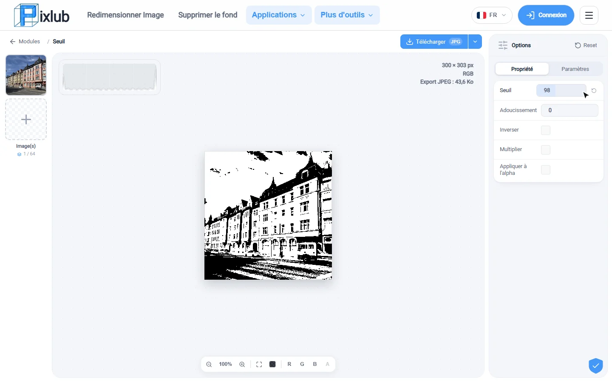

# Seuil

Passer une image en noir et blanc pur selon un seuil de clarté.

**Catégorie** : Ajustement · **Identifiant** : `threshold` · [Référence API](./api.md)

## Où l'utiliser

- **[Page du module](https://pixlub.com/fr/module/threshold)** : Déposez vos fichiers, réglez, téléchargez : le module seul, sans rien d'autre.
- **[Graphe d'image](https://pixlub.com/fr/image/graph)** : Reliez-le à d'autres modules pour composer un effet plus complexe.

## Entrées

Les fichiers que la page du module accepte : déposez-les sur la zone d’import, ou cliquez dessus pour parcourir. Un fichier d’un autre format est écarté, avec un message qui rappelle les formats permis.

| Entrée | Formats acceptés | Fichiers |
| --- | --- | --- |
| **Image(s)** (obligatoire) Image binarisée selon le seuil. | `PNG`, `JPEG`, `WebP`, `GIF`, `AVIF`, `BMP` | Un ou plusieurs : chaque image est traitée à part, avec les mêmes réglages |

Le nombre d’images traitées d’un coup dépend de votre offre.

Par l’API, les fichiers et leurs formats sont détaillés dans la [vue API](./api.md).

## Présentation vidéo

▶ [Voir la vidéo](../../../../assets/modules/threshold/demo.fr.mp4) : Placer le seuil, adoucir, inverser.

1. `0:00` Importer une image
2. `0:03` Placer le seuil
3. `0:06` Adoucir la transition
4. `0:09` Inverser
5. `0:12` Exporter le résultat

## Utilisation

1. **Importer**

   Déposez une ou plusieurs images.

2. **Placer le seuil**

   Ce qui est plus clair devient blanc, le reste noir.

3. **Adoucir**

   L'**adoucissement** remplace la coupure nette par un fondu.

## Réglages

| Réglage | Effet |
| --- | --- |
| **Seuil** | 0 à 255 : clarté à partir de laquelle un pixel devient blanc. |
| **Adoucissement** | 0 à 128 : largeur de la transition. |
| **Inverser** | Échange le noir et le blanc. |
| **Multiplier** | Multiplie le résultat noir et blanc avec l'image d'origine. |
| **Appliquer à l'alpha** | Le seuil porte aussi sur la transparence. |

## Astuces

- Idéal pour nettoyer un document scanné ou préparer un tampon.
- Dans le [graphe d'image](../../../../01-app/fr/02-image/01-image-graph.md), le résultat sert de masque.

## Exportation

Le bouton **Télécharger** enregistre le résultat dans le format du fichier importé : une photo JPEG ressort en JPEG. Le menu à sa droite ouvre les **Paramètres d’export** pour choisir un autre format, régler la qualité, la taille ou le fond, et propose **Copier l’image**.

Avec plusieurs images, le bouton devient **Téléchargement ZIP** ; le menu propose aussi les fichiers séparés, ou la seule image affichée.

- **[La modale d’exportation](../../../../01-app/fr/02-image/04-exportation.md)** : Tous les formats, leurs réglages, le traitement local ou serveur, les lots et le dossier local.
