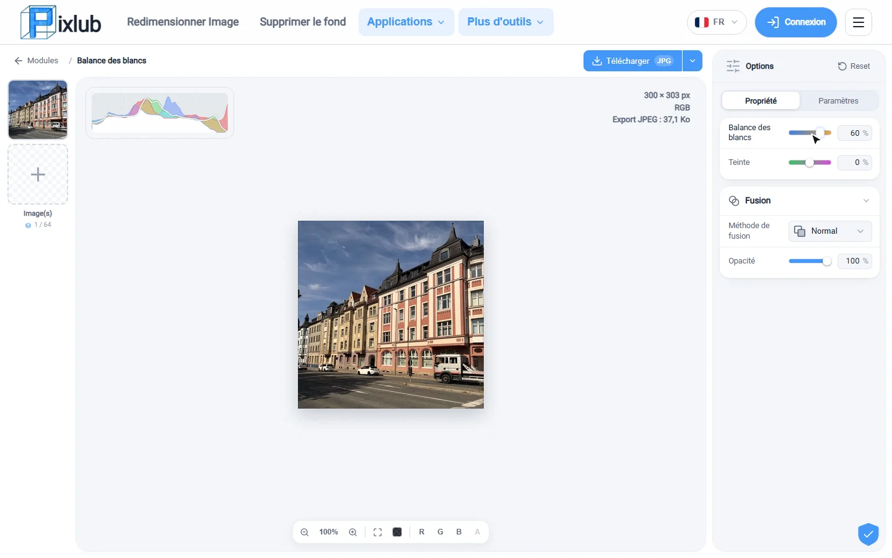

# Balance des blancs

Réchauffer ou refroidir une image et corriger sa dominante verte ou magenta.

**Catégorie** : Ajustement · **Identifiant** : `whiteBalance` · [Référence API](./api.md)

## Où l'utiliser

- **[Page du module](https://pixlub.com/fr/module/whiteBalance)** : Déposez vos fichiers, réglez, téléchargez : le module seul, sans rien d'autre.
- **[Graphe d'image](https://pixlub.com/fr/image/graph)** : Reliez-le à d'autres modules pour composer un effet plus complexe.

## Entrées

Les fichiers que la page du module accepte : déposez-les sur la zone d’import, ou cliquez dessus pour parcourir. Un fichier d’un autre format est écarté, avec un message qui rappelle les formats permis.

| Entrée | Formats acceptés | Fichiers |
| --- | --- | --- |
| **Image(s)** (obligatoire) Image dont la balance des blancs est corrigée. | `PNG`, `JPEG`, `WebP`, `GIF`, `AVIF`, `BMP` | Un ou plusieurs : chaque image est traitée à part, avec les mêmes réglages |

Le nombre d’images traitées d’un coup dépend de votre offre.

Par l’API, les fichiers et leurs formats sont détaillés dans la [vue API](./api.md).

## Présentation vidéo

▶ [Voir la vidéo](../../../../assets/modules/whiteBalance/demo.fr.mp4) : Réchauffer, refroidir, corriger la dominante, doser.

1. `0:00` Importer une image
2. `0:02` Réchauffer ou refroidir
3. `0:10` Corriger la dominante
4. `0:14` Doser avec l’opacité
5. `0:21` Exporter le résultat

## Utilisation

1. **Importer**

   Déposez une ou plusieurs images.

2. **Régler la température**

   Vers la droite l'image se réchauffe, vers la gauche elle refroidit.

3. **Corriger la teinte**

   Si l'image tire au vert ou au magenta.

## Réglages

| Réglage | Effet |
| --- | --- |
| **Balance des blancs** | −100 (bleu) à 100 (jaune orangé). |
| **Teinte** | −100 (vert) à 100 (magenta). |
| **Fusion** | Méthode de fusion et opacité : comment le réglage se pose sur l'image d'origine. |

## Astuces

- Une photo prise sous ampoule tire au jaune : refroidissez-la légèrement.
- Pour régler aussi la lumière, [Ajustement Base](../baseAdjust/README.md) réunit tout.

## Exportation

Le bouton **Télécharger** enregistre le résultat dans le format du fichier importé : une photo JPEG ressort en JPEG. Le menu à sa droite ouvre les **Paramètres d’export** pour choisir un autre format, régler la qualité, la taille ou le fond, et propose **Copier l’image**.

Avec plusieurs images, le bouton devient **Téléchargement ZIP** ; le menu propose aussi les fichiers séparés, ou la seule image affichée.

- **[La modale d’exportation](../../../../01-app/fr/02-image/04-exportation.md)** : Tous les formats, leurs réglages, le traitement local ou serveur, les lots et le dossier local.
