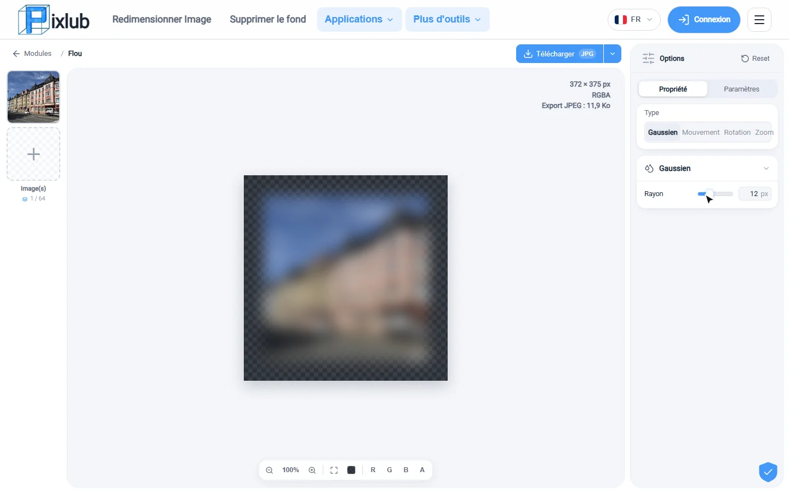

# Flou

Flouter une image : gaussien, de mouvement, de rotation ou de zoom.

**Catégorie** : Filtres · **Identifiant** : `blur` · [Référence API](./api.md)

## Où l'utiliser

- **[Page du module](https://pixlub.com/fr/module/blur)** : Déposez vos fichiers, réglez, téléchargez : le module seul, sans rien d'autre.
- **[Graphe d'image](https://pixlub.com/fr/image/graph)** : Reliez-le à d'autres modules pour composer un effet plus complexe.

## Entrées

Les fichiers que la page du module accepte : déposez-les sur la zone d’import, ou cliquez dessus pour parcourir. Un fichier d’un autre format est écarté, avec un message qui rappelle les formats permis.

| Entrée | Formats acceptés | Fichiers |
| --- | --- | --- |
| **Image(s)** (obligatoire) Image à flouter. | `PNG`, `JPEG`, `WebP`, `GIF`, `AVIF`, `BMP` | Un ou plusieurs : chaque image est traitée à part, avec les mêmes réglages |

Le nombre d’images traitées d’un coup dépend de votre offre.

Par l’API, les fichiers et leurs formats sont détaillés dans la [vue API](./api.md).

## Présentation vidéo

▶ [Voir la vidéo](../../../../assets/modules/blur/demo.fr.mp4) : Gaussien, mouvement, puis zoom avec son centre.

1. `0:00` Importer une image
2. `0:02` Flou gaussien
3. `0:05` Flou de mouvement
4. `0:12` Zoom, centre placé
5. `0:17` Exporter le résultat

## Utilisation

1. **Importer**

   Déposez une ou plusieurs images.

2. **Choisir le type**

   **Gaussien**, **Mouvement**, **Rotation** ou **Zoom**.

3. **Régler**

   Chaque type a son réglage. Pour Rotation et Zoom, cliquez dans l'aperçu pour placer le centre.

## Réglages

| Réglage | Effet |
| --- | --- |
| **Gaussien** | Rayon, 0 à 40 px : un flou uniforme. |
| **Mouvement** | Angle et distance (0 à 500 px) : un filé dans une direction. |
| **Rotation** | Angle de rotation, 0° à 90°, autour du centre. |
| **Zoom** | Intensité, 0 à 100 %, depuis le centre. |
| **Centre X** / **Y** | Position du centre, en %. |

## Astuces

- Un petit rayon gaussien (1 à 3 px) adoucit une peau sans effacer les détails.
- Pour masquer des visages, préférez [Floutage de visages](../../08-api/faceBlurApi/README.md).

## Exportation

Le bouton **Télécharger** enregistre le résultat dans le format du fichier importé : une photo JPEG ressort en JPEG. Le menu à sa droite ouvre les **Paramètres d’export** pour choisir un autre format, régler la qualité, la taille ou le fond, et propose **Copier l’image**.

Avec plusieurs images, le bouton devient **Téléchargement ZIP** ; le menu propose aussi les fichiers séparés, ou la seule image affichée.

- **[La modale d’exportation](../../../../01-app/fr/02-image/04-exportation.md)** : Tous les formats, leurs réglages, le traitement local ou serveur, les lots et le dossier local.
