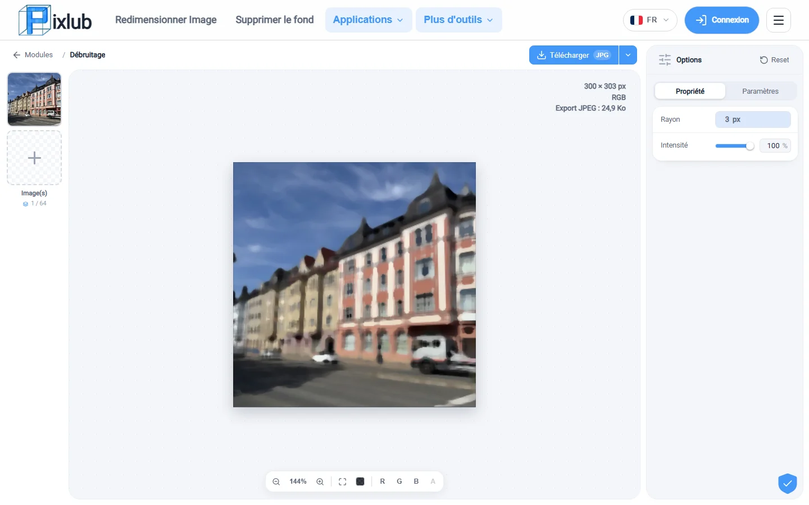

# Débruitage

Réduire le bruit d'une image en préservant ses contours.

**Catégorie** : Filtres · **Identifiant** : `denoise` · [Référence API](./api.md)

## Où l'utiliser

- **[Page du module](https://pixlub.com/fr/module/denoise)** : Déposez vos fichiers, réglez, téléchargez : le module seul, sans rien d'autre.
- **[Graphe d'image](https://pixlub.com/fr/image/graph)** : Reliez-le à d'autres modules pour composer un effet plus complexe.

## Entrées

Les fichiers que la page du module accepte : déposez-les sur la zone d’import, ou cliquez dessus pour parcourir. Un fichier d’un autre format est écarté, avec un message qui rappelle les formats permis.

| Entrée | Formats acceptés | Fichiers |
| --- | --- | --- |
| **Image(s)** (obligatoire) Image dont le bruit est réduit. | `PNG`, `JPEG`, `WebP`, `GIF`, `AVIF`, `BMP` | Un ou plusieurs : chaque image est traitée à part, avec les mêmes réglages |

Le nombre d’images traitées d’un coup dépend de votre offre.

Par l’API, les fichiers et leurs formats sont détaillés dans la [vue API](./api.md).

## Présentation vidéo

▶ [Voir la vidéo](../../../../assets/modules/denoise/demo.fr.mp4) : Rayon du filtre, puis mélange avec l'original.

1. `0:00` Importer une image
2. `0:04` Rayon du filtre
3. `0:07` Doser avec l’original
4. `0:12` Exporter le résultat

## Utilisation

1. **Importer**

   Déposez une ou plusieurs images. Zoomez pour voir le grain.

2. **Régler**

   Le **rayon** fixe la force du lissage, l'**intensité** le mélange avec l'original.

## Réglages

| Réglage | Effet |
| --- | --- |
| **Rayon** | 1 à 3 px. |
| **Intensité** | 0 à 100 % : part de l'image débruitée. |

## Astuces

- Un rayon élevé efface aussi les fins détails : baissez l'intensité pour garder du naturel.

## Exportation

Le bouton **Télécharger** enregistre le résultat dans le format du fichier importé : une photo JPEG ressort en JPEG. Le menu à sa droite ouvre les **Paramètres d’export** pour choisir un autre format, régler la qualité, la taille ou le fond, et propose **Copier l’image**.

Avec plusieurs images, le bouton devient **Téléchargement ZIP** ; le menu propose aussi les fichiers séparés, ou la seule image affichée.

- **[La modale d’exportation](../../../../01-app/fr/02-image/04-exportation.md)** : Tous les formats, leurs réglages, le traitement local ou serveur, les lots et le dossier local.
