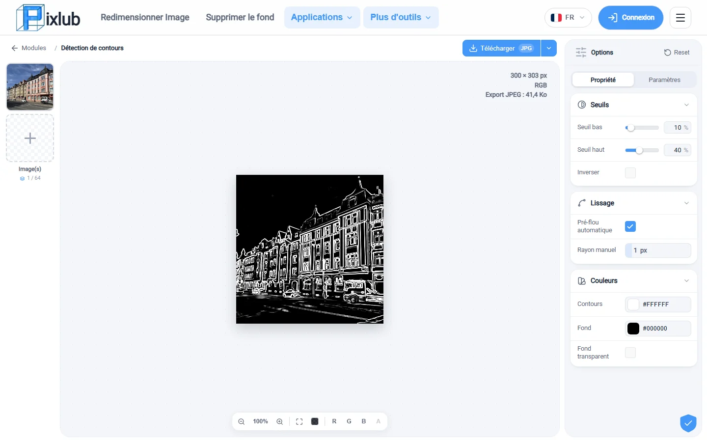

# Détection de contours

Extraire les contours d'une image en traits.

**Catégorie** : Filtres · **Identifiant** : `edgeDetect` · [Référence API](./api.md)

## Où l'utiliser

- **[Page du module](https://pixlub.com/fr/module/edgeDetect)** : Déposez vos fichiers, réglez, téléchargez : le module seul, sans rien d'autre.
- **[Graphe d'image](https://pixlub.com/fr/image/graph)** : Reliez-le à d'autres modules pour composer un effet plus complexe.

## Entrées

Les fichiers que la page du module accepte : déposez-les sur la zone d’import, ou cliquez dessus pour parcourir. Un fichier d’un autre format est écarté, avec un message qui rappelle les formats permis.

| Entrée | Formats acceptés | Fichiers |
| --- | --- | --- |
| **Image(s)** (obligatoire) Image dont les contours sont extraits. | `PNG`, `JPEG`, `WebP`, `GIF`, `AVIF`, `BMP` | Un ou plusieurs : chaque image est traitée à part, avec les mêmes réglages |

Le nombre d’images traitées d’un coup dépend de votre offre.

Par l’API, les fichiers et leurs formats sont détaillés dans la [vue API](./api.md).

## Présentation vidéo

▶ [Voir la vidéo](../../../../assets/modules/edgeDetect/demo.fr.mp4) : Seuils, couleurs et inversion.

1. `0:00` Importer une image
2. `0:03` Seuils
3. `0:08` Couleurs et inversion
4. `0:16` Exporter le résultat

## Utilisation

1. **Importer**

   Déposez une ou plusieurs images : les contours apparaissent sur fond noir.

2. **Régler les seuils**

   Baissez-les pour plus de traits, montez-les pour ne garder que les bords marqués.

3. **Colorer**

   Couleur des traits et du fond, ou fond transparent.

## Réglages

| Réglage | Effet |
| --- | --- |
| **Seuil bas** / **haut** | 0 à 100 % : quels bords sont gardés. |
| **Inverser** | Traits sombres sur fond clair. |
| **Pré-flou automatique** / **Rayon manuel** | Lisse l'image avant la détection pour réduire le bruit. |
| **Contours** / **Fond** | Couleurs des traits et du fond. |
| **Fond transparent** | Ne garde que les traits. |

## Astuces

- Inversé, sur fond blanc, le résultat ressemble à un dessin au trait.
- Avec un fond transparent, superposez les traits à l'image d'origine dans le [graphe d'image](../../../../01-app/fr/02-image/01-image-graph.md).

## Exportation

Le bouton **Télécharger** enregistre le résultat dans le format du fichier importé : une photo JPEG ressort en JPEG. Le menu à sa droite ouvre les **Paramètres d’export** pour choisir un autre format, régler la qualité, la taille ou le fond, et propose **Copier l’image**.

Avec plusieurs images, le bouton devient **Téléchargement ZIP** ; le menu propose aussi les fichiers séparés, ou la seule image affichée.

- **[La modale d’exportation](../../../../01-app/fr/02-image/04-exportation.md)** : Tous les formats, leurs réglages, le traitement local ou serveur, les lots et le dossier local.
