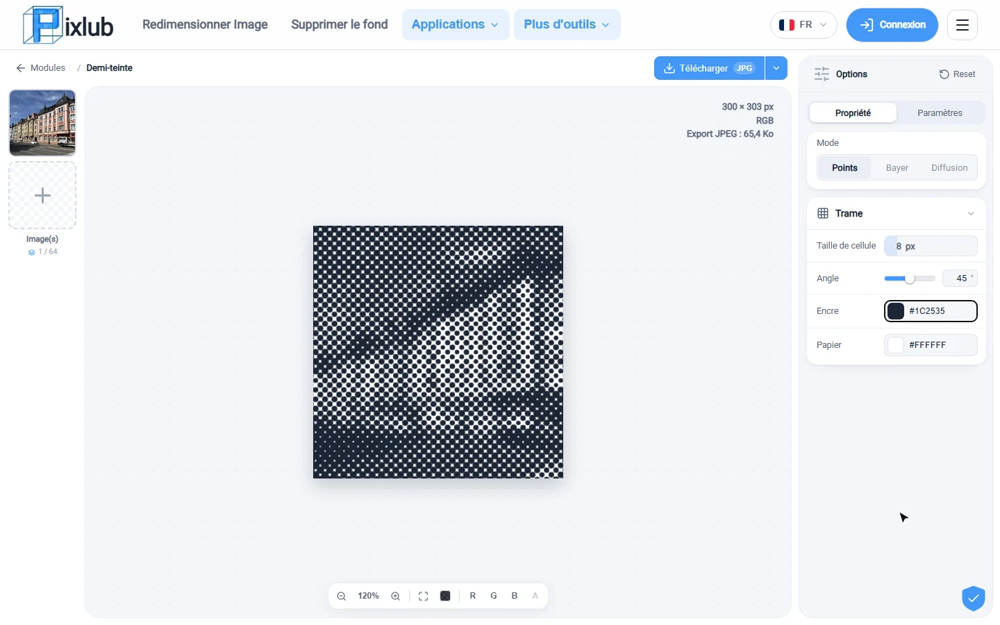

# Demi-teinte

Convertir une image en trame de points ou en tramage, effet rétro ou imprimé.

**Catégorie** : Filtres · **Identifiant** : `halftone` · [Référence API](./api.md)

## Où l'utiliser

- **[Page du module](https://pixlub.com/fr/module/halftone)** : Déposez vos fichiers, réglez, téléchargez : le module seul, sans rien d'autre.
- **[Graphe d'image](https://pixlub.com/fr/image/graph)** : Reliez-le à d'autres modules pour composer un effet plus complexe.

## Entrées

Les fichiers que la page du module accepte : déposez-les sur la zone d’import, ou cliquez dessus pour parcourir. Un fichier d’un autre format est écarté, avec un message qui rappelle les formats permis.

| Entrée | Formats acceptés | Fichiers |
| --- | --- | --- |
| **Image(s)** (obligatoire) Image convertie en trame. | `PNG`, `JPEG`, `WebP`, `GIF`, `AVIF`, `BMP` | Un ou plusieurs : chaque image est traitée à part, avec les mêmes réglages |

Le nombre d’images traitées d’un coup dépend de votre offre.

Par l’API, les fichiers et leurs formats sont détaillés dans la [vue API](./api.md).

## Présentation vidéo

▶ [Voir la vidéo](../../../../assets/modules/halftone/demo.fr.mp4) : Trame de points, encre, puis tramages Bayer et diffusion.

1. `0:00` Importer une image
2. `0:04` Trame de points
3. `0:11` Tramage Bayer et diffusion
4. `0:17` Exporter le résultat

## Utilisation

1. **Importer**

   Déposez une ou plusieurs images.

2. **Choisir le mode**

   **Points** (trame d'imprimerie), **Bayer** (motif régulier) ou **Diffusion** (grain fin).

3. **Régler**

   Taille et angle de la trame, couleurs d'encre et de papier, ou niveaux par canal.

## Réglages

| Réglage | Effet |
| --- | --- |
| **Mode** | Points, Bayer ou Diffusion. |
| **Taille de cellule** / **Angle** | Mode Points : 3 à 40 px, 0° à 90°. |
| **Encre** / **Papier** | Mode Points : couleurs de la trame. |
| **Niveaux par canal** | Bayer et Diffusion : 2 à 8. |

## Astuces

- Diffusion à 2 niveaux donne le rendu des écrans rétro en noir et blanc.

## Exportation

Le bouton **Télécharger** enregistre le résultat dans le format du fichier importé : une photo JPEG ressort en JPEG. Le menu à sa droite ouvre les **Paramètres d’export** pour choisir un autre format, régler la qualité, la taille ou le fond, et propose **Copier l’image**.

Avec plusieurs images, le bouton devient **Téléchargement ZIP** ; le menu propose aussi les fichiers séparés, ou la seule image affichée.

- **[La modale d’exportation](../../../../01-app/fr/02-image/04-exportation.md)** : Tous les formats, leurs réglages, le traitement local ou serveur, les lots et le dossier local.
