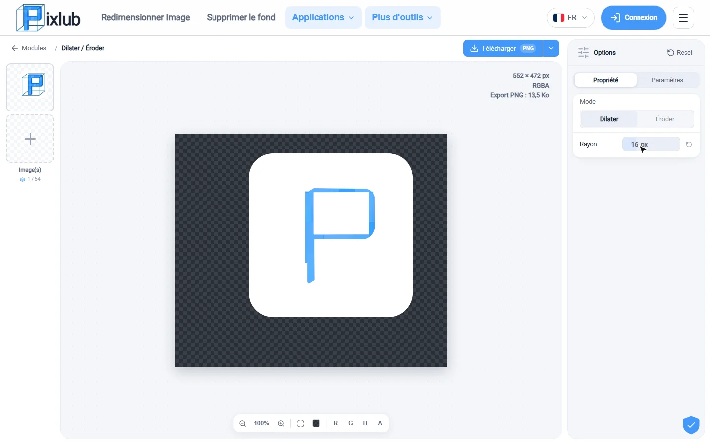

# Dilater / Éroder

Épaissir ou amincir les zones opaques d'une image : masques, silhouettes, contours.

**Catégorie** : Filtres · **Identifiant** : `morphology` · [Référence API](./api.md)

## Où l'utiliser

- **[Page du module](https://pixlub.com/fr/module/morphology)** : Déposez vos fichiers, réglez, téléchargez : le module seul, sans rien d'autre.
- **[Graphe d'image](https://pixlub.com/fr/image/graph)** : Reliez-le à d'autres modules pour composer un effet plus complexe.

## Entrées

Les fichiers que la page du module accepte : déposez-les sur la zone d’import, ou cliquez dessus pour parcourir. Un fichier d’un autre format est écarté, avec un message qui rappelle les formats permis.

| Entrée | Formats acceptés | Fichiers |
| --- | --- | --- |
| **Image(s)** (obligatoire) Image dont les zones opaques sont épaissies ou contractées. | `PNG`, `JPEG`, `WebP`, `GIF`, `AVIF`, `BMP` | Un ou plusieurs : chaque image est traitée à part, avec les mêmes réglages |

Le nombre d’images traitées d’un coup dépend de votre offre.

Par l’API, les fichiers et leurs formats sont détaillés dans la [vue API](./api.md).

## Présentation vidéo

▶ [Voir la vidéo](../../../../assets/modules/morphology/demo.fr.mp4) : Dilater, puis éroder.

1. `0:00` Importer une image détourée
2. `0:03` Dilater
3. `0:06` Éroder
4. `0:09` Exporter le résultat

## Utilisation

1. **Importer**

   Déposez une image avec de la transparence, ou un masque noir et blanc.

2. **Choisir le mode**

   **Dilater** épaissit les zones opaques, **Éroder** les amincit.

3. **Régler le rayon**

   En pixels.

## Réglages

| Réglage | Effet |
| --- | --- |
| **Mode** | Dilater ou éroder. |
| **Rayon** | 1 à 64 px. |

## Astuces

- Éroder de quelques pixels un détourage retire le liseré du fond d'origine.
- Dilater puis éroder du même rayon bouche les petits trous d'un masque.

## Exportation

Le bouton **Télécharger** enregistre le résultat dans le format du fichier importé : une photo JPEG ressort en JPEG. Le menu à sa droite ouvre les **Paramètres d’export** pour choisir un autre format, régler la qualité, la taille ou le fond, et propose **Copier l’image**.

Avec plusieurs images, le bouton devient **Téléchargement ZIP** ; le menu propose aussi les fichiers séparés, ou la seule image affichée.

- **[La modale d’exportation](../../../../01-app/fr/02-image/04-exportation.md)** : Tous les formats, leurs réglages, le traitement local ou serveur, les lots et le dossier local.
