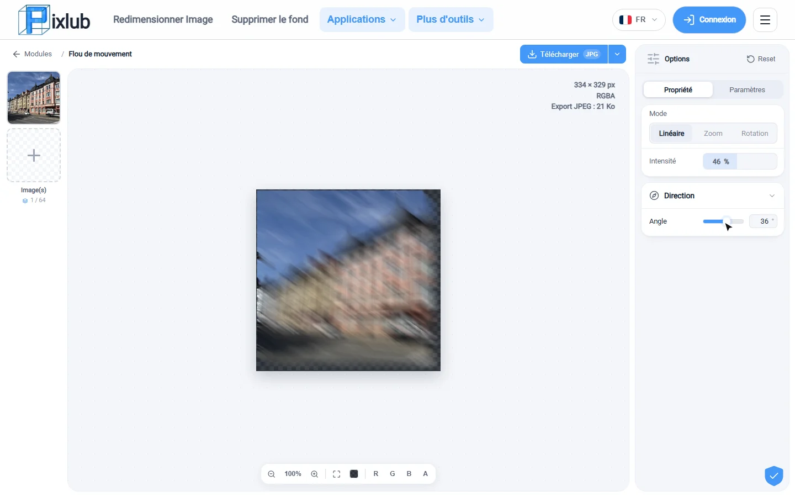

# Flou de mouvement

Donner une impression de vitesse : filé linéaire, zoom ou rotation.

**Catégorie** : Filtres · **Identifiant** : `motionBlur` · [Référence API](./api.md)

## Où l'utiliser

- **[Page du module](https://pixlub.com/fr/module/motionBlur)** : Déposez vos fichiers, réglez, téléchargez : le module seul, sans rien d'autre.
- **[Graphe d'image](https://pixlub.com/fr/image/graph)** : Reliez-le à d'autres modules pour composer un effet plus complexe.

## Entrées

Les fichiers que la page du module accepte : déposez-les sur la zone d’import, ou cliquez dessus pour parcourir. Un fichier d’un autre format est écarté, avec un message qui rappelle les formats permis.

| Entrée | Formats acceptés | Fichiers |
| --- | --- | --- |
| **Image(s)** (obligatoire) Image à laquelle le flou de mouvement est appliqué. | `PNG`, `JPEG`, `WebP`, `GIF`, `AVIF`, `BMP` | Un ou plusieurs : chaque image est traitée à part, avec les mêmes réglages |

Le nombre d’images traitées d’un coup dépend de votre offre.

Par l’API, les fichiers et leurs formats sont détaillés dans la [vue API](./api.md).

## Présentation vidéo

▶ [Voir la vidéo](../../../../assets/modules/motionBlur/demo.fr.mp4) : Filé linéaire, puis zoom et rotation.

1. `0:00` Importer une image
2. `0:02` Filé linéaire
3. `0:08` Zoom et rotation
4. `0:13` Exporter le résultat

## Utilisation

1. **Importer**

   Déposez une ou plusieurs images.

2. **Choisir le mode**

   **Linéaire**, **Zoom** ou **Rotation**.

3. **Doser**

   L'**intensité**, et l'**angle** en mode linéaire.

## Réglages

| Réglage | Effet |
| --- | --- |
| **Mode** | Linéaire, zoom ou rotation. |
| **Intensité** | 0 à 100 %. |
| **Angle** | Mode linéaire : direction du filé, −180° à 180°. |

## Astuces

- Alignez l'angle sur la direction du sujet pour un effet de vitesse crédible.

## Exportation

Le bouton **Télécharger** enregistre le résultat dans le format du fichier importé : une photo JPEG ressort en JPEG. Le menu à sa droite ouvre les **Paramètres d’export** pour choisir un autre format, régler la qualité, la taille ou le fond, et propose **Copier l’image**.

Avec plusieurs images, le bouton devient **Téléchargement ZIP** ; le menu propose aussi les fichiers séparés, ou la seule image affichée.

- **[La modale d’exportation](../../../../01-app/fr/02-image/04-exportation.md)** : Tous les formats, leurs réglages, le traitement local ou serveur, les lots et le dossier local.
