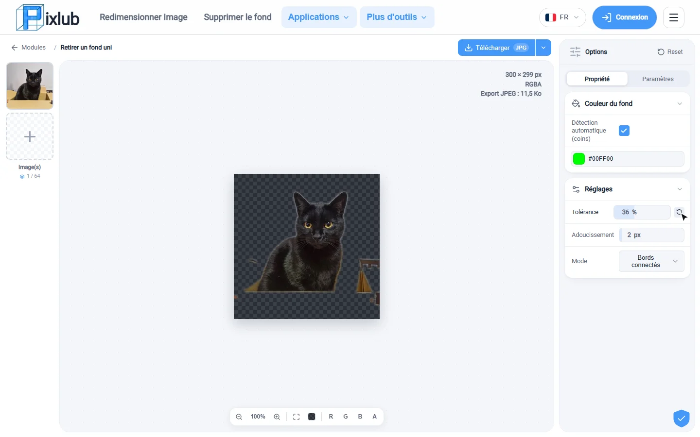

# Retirer un fond uni

Rendre transparent un fond d'une seule couleur : fond vert, studio, mur.

**Catégorie** : Filtres · **Identifiant** : `removeBg` · [Référence API](./api.md)

## Où l'utiliser

- **[Page du module](https://pixlub.com/fr/module/removeBg)** : Déposez vos fichiers, réglez, téléchargez : le module seul, sans rien d'autre.
- **[Graphe d'image](https://pixlub.com/fr/image/graph)** : Reliez-le à d'autres modules pour composer un effet plus complexe.

## Entrées

Les fichiers que la page du module accepte : déposez-les sur la zone d’import, ou cliquez dessus pour parcourir. Un fichier d’un autre format est écarté, avec un message qui rappelle les formats permis.

| Entrée | Formats acceptés | Fichiers |
| --- | --- | --- |
| **Image(s)** (obligatoire) Image dont le fond uni est rendu transparent. | `PNG`, `JPEG`, `WebP`, `GIF`, `AVIF`, `BMP` | Un ou plusieurs : chaque image est traitée à part, avec les mêmes réglages |

Le nombre d’images traitées d’un coup dépend de votre offre.

Par l’API, les fichiers et leurs formats sont détaillés dans la [vue API](./api.md).

## Présentation vidéo

▶ [Voir la vidéo](../../../../assets/modules/removeBg/demo.fr.mp4) : Fond détecté, tolérance, bord adouci, mode.

1. `0:00` Importer une image sur fond uni
2. `0:03` Fond détecté dans les coins
3. `0:06` Adoucir le bord
4. `0:08` Mode de détection
5. `0:16` Exporter le résultat

## Utilisation

1. **Importer**

   Déposez une image sur fond uni : la couleur du fond est lue dans les coins.

2. **Régler la tolérance**

   Montez-la jusqu'à ce que tout le fond disparaisse.

3. **Affiner**

   Adoucissez le bord ; décochez la détection pour choisir la couleur vous-même.

## Réglages

| Réglage | Effet |
| --- | --- |
| **Détection automatique** | Couleur du fond prise dans les coins ; sinon, la **couleur** choisie. |
| **Tolérance** | 0 à 100 % : nuances emportées avec le fond. |
| **Adoucissement** | 0 à 50 px de bord progressif. |
| **Mode** | **Bords connectés** : seulement le fond relié aux bords. **Toute l'image** : partout. |

## Retoucher à la gomme

- Le bouton **Gomme** de l'aperçu l'allume : ses options flottent sur l'image.
- Peignez pour retirer ce qui reste ; **Restaurer** (ou **Alt**) remet ce que le détourage a emporté.
- **Zones gommées en rouge** montre tout ce qui a été retiré.

## Astuces

- Tout se fait dans le navigateur, sans crédit. Pour un fond complexe, utilisez [Suppression du fond](../../08-api/removeBgApi/README.md).
- Exportez en PNG ou WebP pour garder la transparence.

## Exportation

Le bouton **Télécharger** enregistre le résultat dans le format du fichier importé : une photo JPEG ressort en JPEG. Le menu à sa droite ouvre les **Paramètres d’export** pour choisir un autre format, régler la qualité, la taille ou le fond, et propose **Copier l’image**.

Avec plusieurs images, le bouton devient **Téléchargement ZIP** ; le menu propose aussi les fichiers séparés, ou la seule image affichée.

- **[La modale d’exportation](../../../../01-app/fr/02-image/04-exportation.md)** : Tous les formats, leurs réglages, le traitement local ou serveur, les lots et le dossier local.
