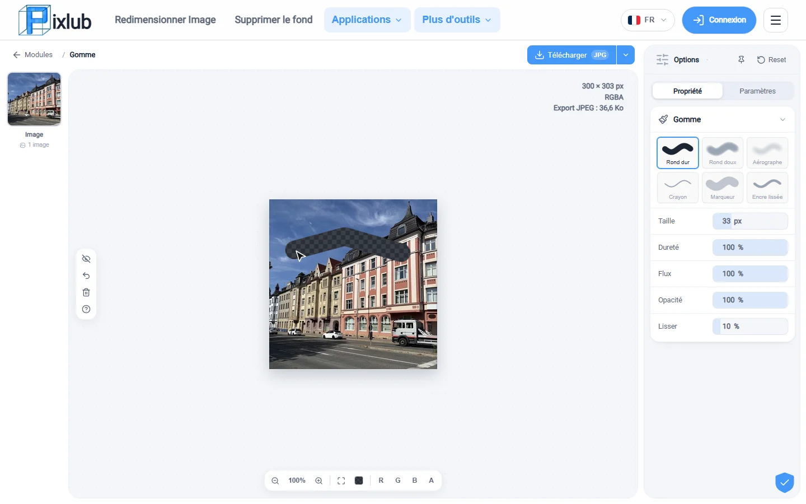

# Gomme

Effacer à la main des parties d'une image, avec une palette de pointes.

**Catégorie** : Composition · **Identifiant** : `eraser` · [Référence API](./api.md)

## Où l'utiliser

- **[Page du module](https://pixlub.com/fr/module/eraser)** : Déposez vos fichiers, réglez, téléchargez : le module seul, sans rien d'autre.
- **[Graphe d'image](https://pixlub.com/fr/image/graph)** : Reliez-le à d'autres modules pour composer un effet plus complexe.

## Entrées

Les fichiers que la page du module accepte : déposez-les sur la zone d’import, ou cliquez dessus pour parcourir. Un fichier d’un autre format est écarté, avec un message qui rappelle les formats permis.

| Entrée | Formats acceptés | Fichiers |
| --- | --- | --- |
| **Image** (obligatoire) Image à gommer. | `PNG`, `JPEG`, `WebP`, `GIF`, `AVIF`, `BMP` | Un fichier |

Par l’API, les fichiers et leurs formats sont détaillés dans la [vue API](./api.md).

## Présentation vidéo

▶ [Voir la vidéo](../../../../assets/modules/eraser/demo.fr.mp4) : Pointe dure, pointe douce, dureté et opacité.

1. `0:00` Importer une image
2. `0:03` Gommer à la pointe dure
3. `0:11` Fondre le bord à la pointe douce
4. `0:15` Dureté et opacité
5. `0:24` Exporter le résultat

## Utilisation

1. **Importer**

   Déposez l'image à gommer.

2. **Choisir une pointe**

   Prenez un pinceau dans la palette, puis ajustez sa taille et sa dureté.

3. **Gommer**

   Peignez dans l'aperçu : ce que la gomme touche devient transparent. **Zones gommées en rouge** montre ce qui est retiré.

## Réglages

| Réglage | Effet |
| --- | --- |
| **Gommer / Restaurer** | Retirer, ou remettre une partie déjà gommée (**Alt** inverse le temps d'un trait). |
| **Pinceaux** | Rond dur, rond doux, aérographe, crayon, marqueur, encre lissée : règle tout d'un coup. |
| **Taille** | Diamètre de la pointe, en pixels de l'image. |
| **Dureté** | 100 % : bord franc. 0 % : bord fondu. |
| **Flux** | Bas, le trait se renforce là où l'on repasse. |
| **Opacité** | Plafond d'un trait : à 50 %, il ne retire que la moitié. |
| **Lisser** | Le trait suit la main avec un léger retard, plus régulier. |

Chaque trait garde la pointe avec laquelle il a été tracé : changer la taille ne touche que les traits suivants.

## Astuces

- **Ctrl + Z** ou « Retirer le dernier trait » défait un trait ; la corbeille les efface tous.
- Exportez en **PNG** ou **WebP** : le JPEG ne garde pas la transparence.

## Exportation

Le bouton **Télécharger** enregistre le résultat dans le format du fichier importé : une photo JPEG ressort en JPEG. Le menu à sa droite ouvre les **Paramètres d’export** pour choisir un autre format, régler la qualité, la taille ou le fond, et propose **Copier l’image**.

- **[La modale d’exportation](../../../../01-app/fr/02-image/04-exportation.md)** : Tous les formats, leurs réglages, le traitement local ou serveur, les lots et le dossier local.
