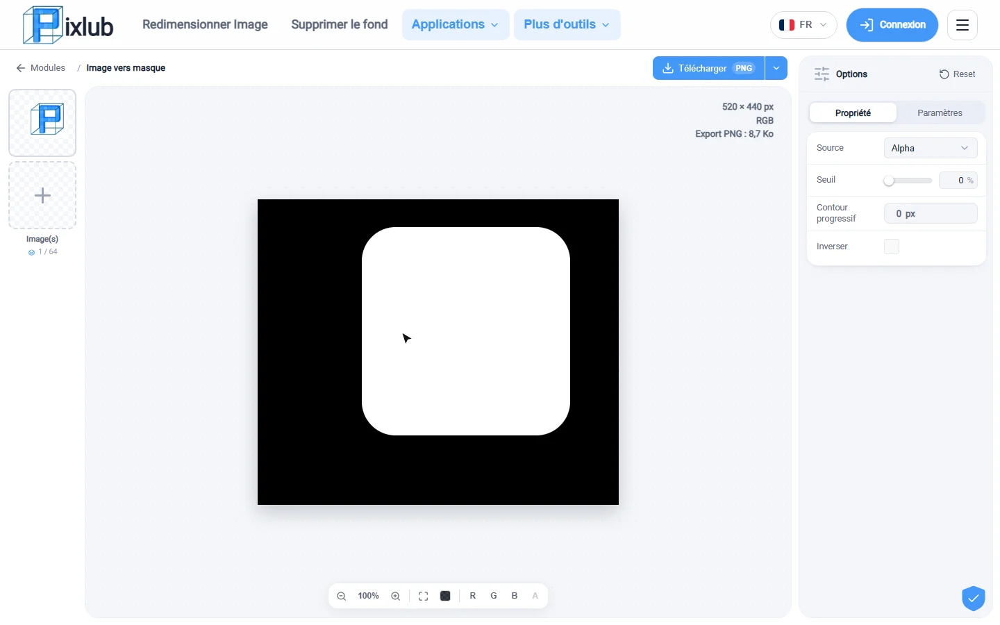

# Image vers masque

Transformer une image en masque noir et blanc, d'après sa transparence, un canal ou sa clarté.

**Catégorie** : Composition · **Identifiant** : `imageToMask` · [Référence API](./api.md)

## Où l'utiliser

- **[Page du module](https://pixlub.com/fr/module/imageToMask)** : Déposez vos fichiers, réglez, téléchargez : le module seul, sans rien d'autre.
- **[Graphe d'image](https://pixlub.com/fr/image/graph)** : Reliez-le à d'autres modules pour composer un effet plus complexe.

## Entrées

Les fichiers que la page du module accepte : déposez-les sur la zone d’import, ou cliquez dessus pour parcourir. Un fichier d’un autre format est écarté, avec un message qui rappelle les formats permis.

| Entrée | Formats acceptés | Fichiers |
| --- | --- | --- |
| **Image(s)** (obligatoire) Image convertie en masque (par son alpha, un canal ou sa luminance). | `PNG`, `JPEG`, `WebP`, `GIF`, `AVIF`, `BMP` | Un ou plusieurs : chaque image est traitée à part, avec les mêmes réglages |

Le nombre d’images traitées d’un coup dépend de votre offre.

Par l’API, les fichiers et leurs formats sont détaillés dans la [vue API](./api.md).

## Présentation vidéo

▶ [Voir la vidéo](../../../../assets/modules/imageToMask/demo.fr.mp4) : Source du masque, seuil, contour progressif, inversion.

1. `0:00` Importer une image détourée
2. `0:03` Choisir la source du masque
3. `0:06` Seuil et contour progressif
4. `0:12` Inverser
5. `0:14` Exporter le résultat

## Utilisation

1. **Importer**

   Déposez une ou plusieurs images.

2. **Choisir la source**

   **Alpha**, **luminance** ou un canal **rouge**, **vert**, **bleu**.

3. **Affiner**

   Un **seuil** pour un masque net, un **contour progressif** pour un bord doux.

## Réglages

| Réglage | Effet |
| --- | --- |
| **Source** | Alpha, luminance, rouge, vert ou bleu. |
| **Seuil** | 0 à 100 %. À 0, le masque reste en dégradé. |
| **Contour progressif** | 0 à 100 px. |
| **Inverser** | Blanc ↔ noir. |

## Astuces

- Le masque obtenu se pose ensuite avec [Masque](../mask/README.md), sur une autre image.

## Exportation

Le bouton **Télécharger** enregistre le résultat dans le format du fichier importé : une photo JPEG ressort en JPEG. Le menu à sa droite ouvre les **Paramètres d’export** pour choisir un autre format, régler la qualité, la taille ou le fond, et propose **Copier l’image**.

Avec plusieurs images, le bouton devient **Téléchargement ZIP** ; le menu propose aussi les fichiers séparés, ou la seule image affichée.

- **[La modale d’exportation](../../../../01-app/fr/02-image/04-exportation.md)** : Tous les formats, leurs réglages, le traitement local ou serveur, les lots et le dossier local.
