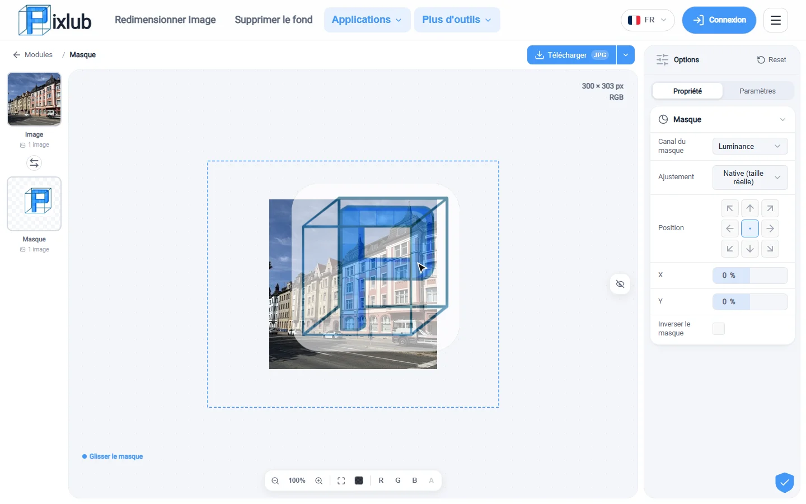

# Masque

Rendre une image transparente là où un masque est noir.

**Catégorie** : Composition · **Identifiant** : `mask` · [Référence API](./api.md)

## Où l'utiliser

- **[Page du module](https://pixlub.com/fr/module/mask)** : Déposez vos fichiers, réglez, téléchargez : le module seul, sans rien d'autre.
- **[Graphe d'image](https://pixlub.com/fr/image/graph)** : Reliez-le à d'autres modules pour composer un effet plus complexe.

## Entrées

Les fichiers que la page du module accepte : déposez-les sur la zone d’import, ou cliquez dessus pour parcourir. Un fichier d’un autre format est écarté, avec un message qui rappelle les formats permis.

| Entrée | Formats acceptés | Fichiers |
| --- | --- | --- |
| **Image** (obligatoire) Image dont l'opacité est modulée. | `PNG`, `JPEG`, `WebP`, `GIF`, `AVIF`, `BMP` | Un fichier |
| **Masque** (obligatoire) Masque : sa luminance (ou son alpha) fixe l'opacité de l'image, blanc = visible, noir = transparent. | `PNG`, `JPEG`, `WebP`, `GIF`, `AVIF`, `BMP` | Un fichier |

Par l’API, les fichiers et leurs formats sont détaillés dans la [vue API](./api.md).

## Présentation vidéo

▶ [Voir la vidéo](../../../../assets/modules/mask/demo.fr.mp4) : Image et masque, canal, ajustement et position, inversion.

1. `0:00` Importer l’image et le masque
2. `0:05` Canal du masque
3. `0:09` Ajustement et position
4. `0:14` Inverser le masque
5. `0:16` Exporter le résultat

## Utilisation

1. **Importer**

   L'**image** dans la première case, le **masque** dans la seconde.

2. **Choisir le canal**

   La **luminance** du masque (blanc = visible) ou son **alpha**.

3. **Caler le masque**

   Ajustement (native, contenir, couvrir, étirer), position et décalage.

## Réglages

| Réglage | Effet |
| --- | --- |
| **Canal du masque** | Luminance ou alpha. |
| **Ajustement** | Taille réelle, contenir, couvrir ou étirer. |
| **Position** / **X** / **Y** | Place du masque sur l'image. |
| **Inverser le masque** | Ce qui était visible devient transparent. |

## Astuces

- Fabriquez un masque avec [Dessiner un masque](../../07-generate/drawShape/README.md) ou [Image vers masque](../imageToMask/README.md).

## Exportation

Le bouton **Télécharger** enregistre le résultat dans le format du fichier importé : une photo JPEG ressort en JPEG. Le menu à sa droite ouvre les **Paramètres d’export** pour choisir un autre format, régler la qualité, la taille ou le fond, et propose **Copier l’image**.

- **[La modale d’exportation](../../../../01-app/fr/02-image/04-exportation.md)** : Tous les formats, leurs réglages, le traitement local ou serveur, les lots et le dossier local.
