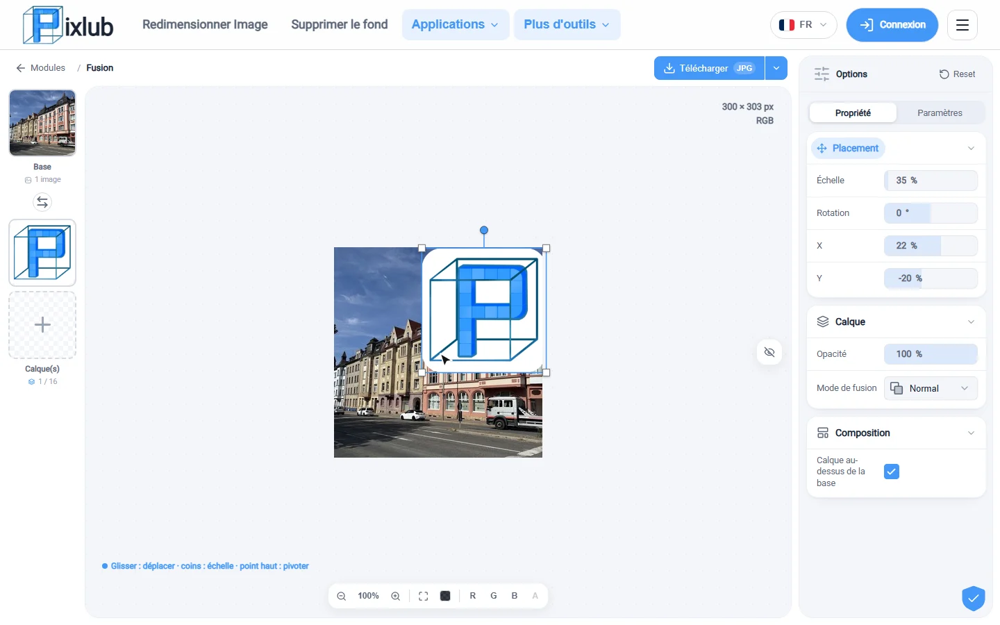

# Fusion

Superposer un ou plusieurs calques sur une image de fond.

**Catégorie** : Composition · **Identifiant** : `merge` · [Référence API](./api.md)

## Où l'utiliser

- **[Page du module](https://pixlub.com/fr/module/merge)** : Déposez vos fichiers, réglez, téléchargez : le module seul, sans rien d'autre.
- **[Graphe d'image](https://pixlub.com/fr/image/graph)** : Reliez-le à d'autres modules pour composer un effet plus complexe.

## Entrées

Les fichiers que la page du module accepte : déposez-les sur la zone d’import, ou cliquez dessus pour parcourir. Un fichier d’un autre format est écarté, avec un message qui rappelle les formats permis.

| Entrée | Formats acceptés | Fichiers |
| --- | --- | --- |
| **Base** (obligatoire) Image de fond sur laquelle les calques sont posés. | `PNG`, `JPEG`, `WebP`, `GIF`, `AVIF`, `BMP` | Un fichier |
| **Calque(s)** (obligatoire) Calque ou batch de calques superposés à la base, dans l'ordre. | `PNG`, `JPEG`, `WebP`, `GIF`, `AVIF`, `BMP` | Jusqu’à 16 fichiers, réunis en un lot |

Par l’API, les fichiers et leurs formats sont détaillés dans la [vue API](./api.md).

## Présentation vidéo

▶ [Voir la vidéo](../../../../assets/modules/merge/demo.fr.mp4) : Base et calque, échelle, placement à la souris, opacité et mode de fusion.

1. `0:00` Importer la base et le calque
2. `0:05` Mettre le calque à l’échelle
3. `0:09` Le placer à la souris
4. `0:12` Opacité et mode de fusion
5. `0:18` Exporter le résultat

## Utilisation

1. **Importer**

   La **base** dans la première case, le ou les **calques** dans la seconde.

2. **Placer le calque**

   Dans l'aperçu : glissez pour déplacer, tirez un coin pour l'échelle, le point haut pour pivoter.

3. **Mélanger**

   **Opacité** et **mode de fusion** du calque.

## Réglages

| Réglage | Effet |
| --- | --- |
| **Placement** | Échelle, rotation et décalage X / Y du calque. |
| **Opacité** / **Mode de fusion** | Comment le calque se pose sur la base. |
| **Calque au-dessus de la base** | Décoché, la base recouvre le calque. |
| **Calques** | Avec plusieurs calques : une liste, chacun avec son placement et sa fusion. |

## Astuces

- Un logo en PNG détouré, réduit et posé dans un coin : un filigrane en quelques secondes.

## Exportation

Le bouton **Télécharger** enregistre le résultat dans le format du fichier importé : une photo JPEG ressort en JPEG. Le menu à sa droite ouvre les **Paramètres d’export** pour choisir un autre format, régler la qualité, la taille ou le fond, et propose **Copier l’image**.

Avec plusieurs images, le bouton devient **Téléchargement ZIP** ; le menu propose aussi les fichiers séparés, ou la seule image affichée.

- **[La modale d’exportation](../../../../01-app/fr/02-image/04-exportation.md)** : Tous les formats, leurs réglages, le traitement local ou serveur, les lots et le dossier local.
