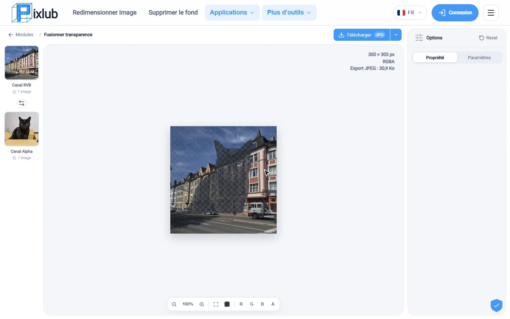

# Fusionner transparence

Recomposer une image transparente à partir de ses couleurs et d'un masque de transparence.

**Catégorie** : Composition · **Identifiant** : `mergeAlpha` · [Référence API](./api.md)

## Où l'utiliser

- **[Page du module](https://pixlub.com/fr/module/mergeAlpha)** : Déposez vos fichiers, réglez, téléchargez : le module seul, sans rien d'autre.
- **[Graphe d'image](https://pixlub.com/fr/image/graph)** : Reliez-le à d'autres modules pour composer un effet plus complexe.

## Entrées

Les fichiers que la page du module accepte : déposez-les sur la zone d’import, ou cliquez dessus pour parcourir. Un fichier d’un autre format est écarté, avec un message qui rappelle les formats permis.

| Entrée | Formats acceptés | Fichiers |
| --- | --- | --- |
| **Canal RVB** (obligatoire) Image dont les couleurs (RVB) sont gardées. | `PNG`, `JPEG`, `WebP`, `GIF`, `AVIF`, `BMP` | Un fichier |
| **Canal Alpha** (obligatoire) Image en niveaux de gris qui devient la transparence du résultat, blanc = opaque. | `PNG`, `JPEG`, `WebP`, `GIF`, `AVIF`, `BMP` | Un fichier |

Par l’API, les fichiers et leurs formats sont détaillés dans la [vue API](./api.md).

## Présentation vidéo

▶ [Voir la vidéo](../../../../assets/modules/mergeAlpha/demo.fr.mp4) : Les couleurs, puis le masque qui devient la transparence.

1. `0:00` Importer les deux images
2. `0:02` La seconde devient la transparence
3. `0:05` Exporter le résultat

## Utilisation

1. **Importer les couleurs**

   Première case : l'image dont les couleurs sont gardées.

2. **Importer la transparence**

   Seconde case : une image en niveaux de gris. Blanc = opaque, noir = transparent.

## Astuces

- Utile pour réassembler une image après avoir traité séparément sa couleur et son alpha.
- Exportez en PNG ou WebP pour garder la transparence.

## Exportation

Le bouton **Télécharger** enregistre le résultat dans le format du fichier importé : une photo JPEG ressort en JPEG. Le menu à sa droite ouvre les **Paramètres d’export** pour choisir un autre format, régler la qualité, la taille ou le fond, et propose **Copier l’image**.

- **[La modale d’exportation](../../../../01-app/fr/02-image/04-exportation.md)** : Tous les formats, leurs réglages, le traitement local ou serveur, les lots et le dossier local.
