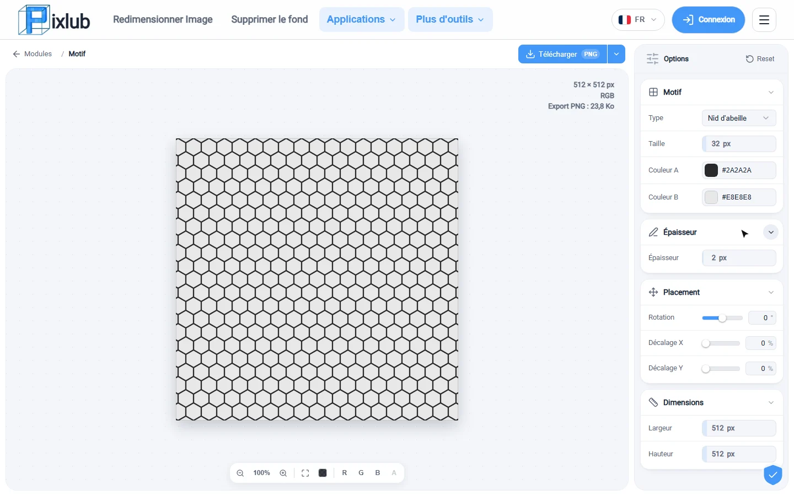

# Motif

Générer un motif répété : damier, grille, points, rayures, briques, nid d'abeille.

**Catégorie** : Génération · **Identifiant** : `checker`

## Où l'utiliser

- **[Page du module](https://pixlub.com/fr/module/checker)** : Déposez vos fichiers, réglez, téléchargez : le module seul, sans rien d'autre.
- **[Graphe d'image](https://pixlub.com/fr/image/graph)** : Reliez-le à d'autres modules pour composer un effet plus complexe.

## Entrées

Ce module n’a pas d’entrée : il crée l’image à partir de ses seuls réglages.

## Présentation vidéo

▶ [Voir la vidéo](../../../../assets/modules/checker/demo.fr.mp4) : Briques puis nid d'abeille, taille, couleur, rotation.

1. `0:00` Le rendu s’affiche d’emblée
2. `0:01` Choisir le motif
3. `0:08` Taille et couleurs
4. `0:17` Rotation
5. `0:20` Exporter le résultat

## Utilisation

1. **Choisir le motif**

   Damier, grille, points, rayures, briques ou nid d'abeille.

2. **Régler**

   **Taille**, **couleurs A et B**, épaisseur ou largeur de bande selon le motif.

3. **Placer**

   Rotation et décalage.

## Réglages

| Réglage | Effet |
| --- | --- |
| **Type** | Le motif répété. |
| **Taille** | 4 à 512 px. |
| **Couleur A** / **B** | Les deux couleurs. |
| **Épaisseur** | Grille, points, briques, nid d'abeille. |
| **Largeur de bande** / **Douceur** | Rayures. |
| **Rotation** / **Décalage** | Orientation et position du motif. |
| **Dimensions** | Taille de l'image. |

## Astuces

- Des rayures douces à faible contraste font un fond discret pour une présentation.

## Exportation

Le bouton **Télécharger** enregistre le résultat dans le format du fichier importé : une photo JPEG ressort en JPEG. Le menu à sa droite ouvre les **Paramètres d’export** pour choisir un autre format, régler la qualité, la taille ou le fond, et propose **Copier l’image**.

- **[La modale d’exportation](../../../../01-app/fr/02-image/04-exportation.md)** : Tous les formats, leurs réglages, le traitement local ou serveur, les lots et le dossier local.
