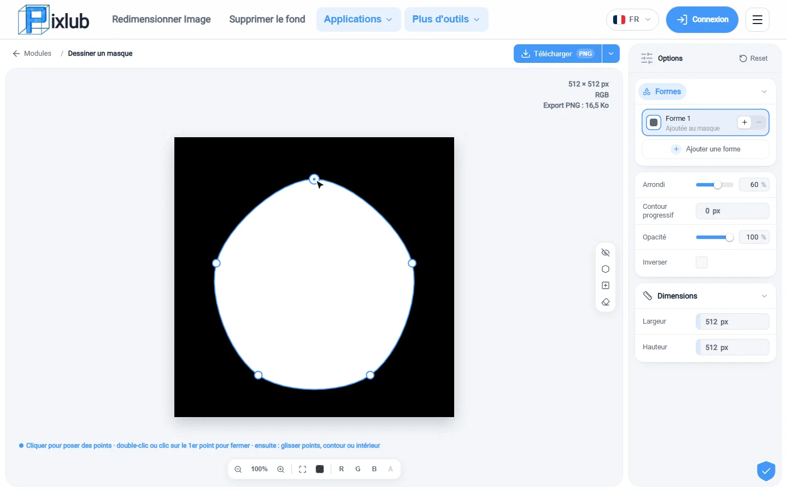

# Dessiner un masque

Dessiner des formes au point près, à ajouter ou à soustraire, pour obtenir un masque.

**Catégorie** : Génération · **Identifiant** : `drawShape`

## Où l'utiliser

- **[Page du module](https://pixlub.com/fr/module/drawShape)** : Déposez vos fichiers, réglez, téléchargez : le module seul, sans rien d'autre.
- **[Graphe d'image](https://pixlub.com/fr/image/graph)** : Reliez-le à d'autres modules pour composer un effet plus complexe.

## Entrées

Ce module n’a pas d’entrée : il crée l’image à partir de ses seuls réglages.

## Présentation vidéo

▶ [Voir la vidéo](../../../../assets/modules/drawShape/demo.fr.mp4) : Poser les points, arrondir, adoucir, inverser.

1. `0:00` Le rendu s’affiche d’emblée
2. `0:01` Poser les points
3. `0:09` Arrondi et contour progressif
4. `0:14` Inverser le masque
5. `0:16` Exporter le résultat

## Utilisation

1. **Poser les points**

   Cliquez dans l'aperçu pour chaque sommet ; un clic sur le premier point ferme la forme.

2. **Ajuster**

   Glissez un point, le contour ou l'intérieur. La liste **Formes** en ajoute d'autres, en ajout ou en soustraction.

3. **Adoucir**

   **Arrondi**, **contour progressif** et **opacité**.

## Réglages

| Réglage | Effet |
| --- | --- |
| **Formes** | Liste des formes, chacune en ajout ou en soustraction. |
| **Arrondi** | 0 à 100 % : courbure des sommets. |
| **Contour progressif** | 0 à 200 px de bord adouci. |
| **Opacité** / **Inverser** | Densité du masque, et blanc ↔ noir. |
| **Dimensions** | Taille du masque. |

## Astuces

- Le masque sert dans le [graphe d'image](../../../../01-app/fr/02-image/01-image-graph.md) pour limiter un effet à une zone.
- Un double-clic sur un point le retire.

## Exportation

Le bouton **Télécharger** enregistre le résultat dans le format du fichier importé : une photo JPEG ressort en JPEG. Le menu à sa droite ouvre les **Paramètres d’export** pour choisir un autre format, régler la qualité, la taille ou le fond, et propose **Copier l’image**.

- **[La modale d’exportation](../../../../01-app/fr/02-image/04-exportation.md)** : Tous les formats, leurs réglages, le traitement local ou serveur, les lots et le dossier local.
