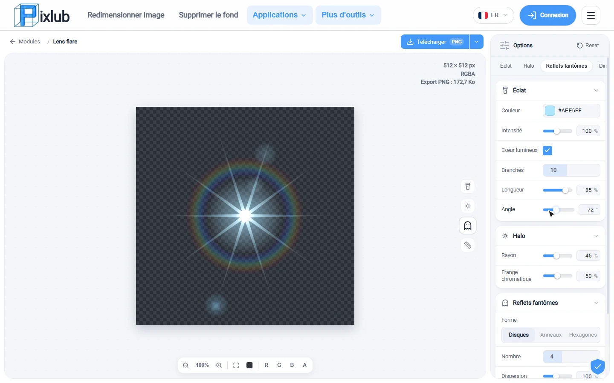

# Lens flare

Générer un éclat d'objectif : cœur, branches en étoile, halo et reflets.

**Catégorie** : Génération · **Identifiant** : `flare`

## Où l'utiliser

- **[Page du module](https://pixlub.com/fr/module/flare)** : Déposez vos fichiers, réglez, téléchargez : le module seul, sans rien d'autre.
- **[Graphe d'image](https://pixlub.com/fr/image/graph)** : Reliez-le à d'autres modules pour composer un effet plus complexe.

## Entrées

Ce module n’a pas d’entrée : il crée l’image à partir de ses seuls réglages.

## Présentation vidéo

▶ [Voir la vidéo](../../../../assets/modules/flare/demo.fr.mp4) : Branches, halo et frange, reflets fantômes.

1. `0:00` Le rendu s’affiche d’emblée
2. `0:01` Branches en étoile
3. `0:07` Halo et frange
4. `0:13` Reflets fantômes
5. `0:17` Exporter le résultat

## Utilisation

1. **Ouvrir**

   L'éclat s'affiche sur fond transparent.

2. **Régler l'étoile**

   Nombre de **branches**, longueur et angle.

3. **Ajouter halo et reflets**

   Rayon du halo, frange colorée, forme et nombre des reflets.

## Réglages

| Réglage | Effet |
| --- | --- |
| **Couleur** / **Intensité** | Teinte et force de l'éclat. |
| **Cœur lumineux** | Point blanc au centre. |
| **Branches** / **Longueur** / **Angle** | L'étoile. |
| **Halo** / **Frange chromatique** | Anneau coloré autour du cœur. |
| **Reflets fantômes** | Disques, anneaux ou hexagones : nombre, dispersion, opacité. |
| **Taille** | 64 à 4000 px. |

## Astuces

- Posez l'éclat sur une photo dans le [graphe d'image](../../../../01-app/fr/02-image/01-image-graph.md) avec la fusion **Écran**.

## Exportation

Le bouton **Télécharger** enregistre le résultat dans le format du fichier importé : une photo JPEG ressort en JPEG. Le menu à sa droite ouvre les **Paramètres d’export** pour choisir un autre format, régler la qualité, la taille ou le fond, et propose **Copier l’image**.

- **[La modale d’exportation](../../../../01-app/fr/02-image/04-exportation.md)** : Tous les formats, leurs réglages, le traitement local ou serveur, les lots et le dossier local.
