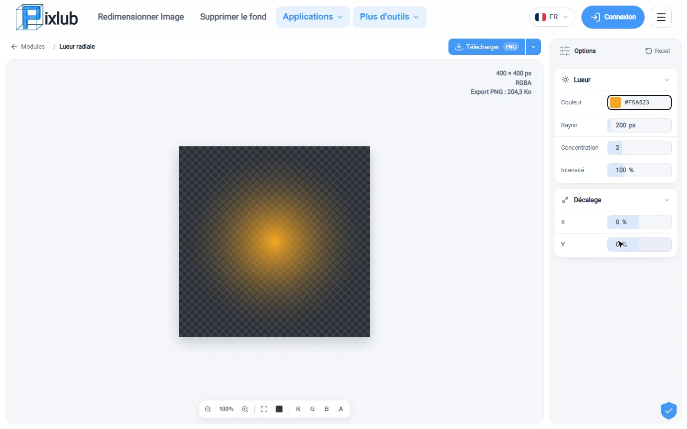

# Lueur radiale

Générer une lueur ronde qui s'estompe vers les bords.

**Catégorie** : Génération · **Identifiant** : `glow`

## Où l'utiliser

- **[Page du module](https://pixlub.com/fr/module/glow)** : Déposez vos fichiers, réglez, téléchargez : le module seul, sans rien d'autre.
- **[Graphe d'image](https://pixlub.com/fr/image/graph)** : Reliez-le à d'autres modules pour composer un effet plus complexe.

## Entrées

Ce module n’a pas d’entrée : il crée l’image à partir de ses seuls réglages.

## Présentation vidéo

▶ [Voir la vidéo](../../../../assets/modules/glow/demo.fr.mp4) : Couleur, rayon et concentration, décalage.

1. `0:00` Le rendu s’affiche d’emblée
2. `0:01` Couleur
3. `0:06` Rayon et concentration
4. `0:12` Décaler la lueur
5. `0:14` Exporter le résultat

## Utilisation

1. **Choisir la couleur**

   La lueur s'affiche sur fond transparent.

2. **Régler**

   **Rayon**, **concentration** (plus haute : cœur plus serré) et **intensité**.

## Réglages

| Réglage | Effet |
| --- | --- |
| **Couleur** | Teinte de la lueur. |
| **Rayon** | 1 à 4000 px. |
| **Concentration** | 0,2 à 8. |
| **Intensité** | 0 à 400 %. |
| **Décalage X** / **Y** | Position de la lueur. |

## Astuces

- Une lueur chaude décalée dans un coin imite un rayon de soleil entrant dans l'image.

## Exportation

Le bouton **Télécharger** enregistre le résultat dans le format du fichier importé : une photo JPEG ressort en JPEG. Le menu à sa droite ouvre les **Paramètres d’export** pour choisir un autre format, régler la qualité, la taille ou le fond, et propose **Copier l’image**.

- **[La modale d’exportation](../../../../01-app/fr/02-image/04-exportation.md)** : Tous les formats, leurs réglages, le traitement local ou serveur, les lots et le dossier local.
