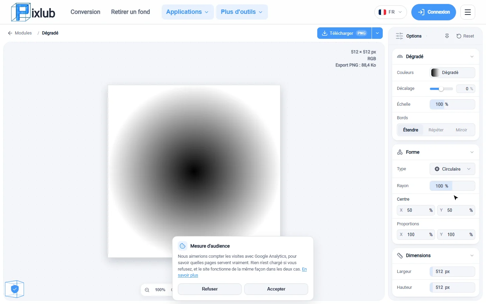

# Dégradé

Générer un dégradé linéaire, circulaire, radial ou en losange.

**Catégorie** : Génération · **Identifiant** : `gradient`

## Où l'utiliser

- **[Page du module](https://pixlub.com/fr/module/gradient)** : Déposez vos fichiers, réglez, téléchargez : le module seul, sans rien d'autre.
- **[Graphe d'image](https://pixlub.com/fr/image/graph)** : Reliez-le à d'autres modules pour composer un effet plus complexe.

## Entrées

Ce module n’a pas d’entrée : il crée l’image à partir de ses seuls réglages.

## Présentation vidéo

▶ [Voir la vidéo](../../../../assets/modules/gradient/demo.fr.mp4) : Forme, couleurs, échelle et bords.

1. `0:00` Le rendu s’affiche d’emblée
2. `0:01` Choisir la forme
3. `0:09` Échelle et bords
4. `0:14` Décaler les couleurs
5. `0:18` Exporter le résultat

## Utilisation

1. **Choisir la forme**

   Linéaire, circulaire, radiale ou en losange.

2. **Choisir les couleurs**

   Placez les arrêts du dégradé, de 0 % (départ ou centre) à 100 % (arrivée ou bord).

3. **Placer**

   Angle, centre, rayon ou proportions selon la forme ; échelle et décalage pour resserrer ou faire glisser les couleurs.

## Réglages

| Réglage | Effet |
| --- | --- |
| **Couleurs** | Les arrêts du dégradé. |
| **Décalage** | Fait glisser les couleurs, −100 à 100 %. |
| **Échelle** | Longueur du dégradé, 1 à 1000 %. |
| **Bords** | Au-delà des bouts : **Étendre**, **Répéter** ou **Miroir**. |
| **Type** | **Linéaire**, **Circulaire**, **Radial** (un tour autour du centre) ou **Losange**. |
| **Angle** | Linéaire, radial et losange ; 0° va de gauche à droite. |
| **Rayon** | Circulaire ; 100 % touche les bords. |
| **Centre** | Position du centre, en % de l'image. |
| **Proportions** | Circulaire et losange : étirement en X et en Y. |
| **Dimensions** | Taille de l'image. |

## Astuces

- Échelle basse et bords en **Miroir** : des ondes régulières, qu'un décalage animé fait défiler sans saut.
- En **Carte** du [Remappage de texture](../../03-transform/remap/README.md), un dégradé radial noir → rouge étire un bruit en rayons.

## Exportation

Le bouton **Télécharger** enregistre le résultat dans le format du fichier importé : une photo JPEG ressort en JPEG. Le menu à sa droite ouvre les **Paramètres d’export** pour choisir un autre format, régler la qualité, la taille ou le fond, et propose **Copier l’image**.

- **[La modale d’exportation](../../../../01-app/fr/02-image/04-exportation.md)** : Tous les formats, leurs réglages, le traitement local ou serveur, les lots et le dossier local.
