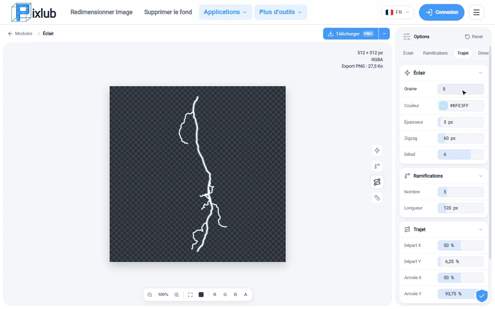

# Éclair

Générer un éclair ramifié entre deux points.

**Catégorie** : Génération · **Identifiant** : `lightning`

## Où l'utiliser

- **[Page du module](https://pixlub.com/fr/module/lightning)** : Déposez vos fichiers, réglez, téléchargez : le module seul, sans rien d'autre.
- **[Graphe d'image](https://pixlub.com/fr/image/graph)** : Reliez-le à d'autres modules pour composer un effet plus complexe.

## Entrées

Ce module n’a pas d’entrée : il crée l’image à partir de ses seuls réglages.

## Présentation vidéo

▶ [Voir la vidéo](../../../../assets/modules/lightning/demo.fr.mp4) : Graine, zigzag et ramifications, trajet.

1. `0:00` Le rendu s’affiche d’emblée
2. `0:01` Changer la graine
3. `0:05` Zigzag et ramifications
4. `0:11` Trajet de l’éclair
5. `0:13` Exporter le résultat

## Utilisation

1. **Changer la graine**

   Chaque graine donne un autre éclair.

2. **Régler la forme**

   **Zigzag**, **détail**, nombre et longueur des **ramifications**.

3. **Placer le trajet**

   Points de départ et d'arrivée, en %.

## Réglages

| Réglage | Effet |
| --- | --- |
| **Graine** | Tirage de l'éclair. |
| **Couleur** / **Épaisseur** | Aspect du trait. |
| **Zigzag** / **Détail** | Amplitude et finesse des brisures. |
| **Ramifications** | Nombre (0 à 24) et longueur. |
| **Trajet** | Départ et arrivée X / Y. |
| **Dimensions** | Taille de la zone. |

## Astuces

- Ajoutez [Bloom](../../05-filter/bloom/README.md) sur l'éclair pour un halo électrique.

## Exportation

Le bouton **Télécharger** enregistre le résultat dans le format du fichier importé : une photo JPEG ressort en JPEG. Le menu à sa droite ouvre les **Paramètres d’export** pour choisir un autre format, régler la qualité, la taille ou le fond, et propose **Copier l’image**.

- **[La modale d’exportation](../../../../01-app/fr/02-image/04-exportation.md)** : Tous les formats, leurs réglages, le traitement local ou serveur, les lots et le dossier local.
