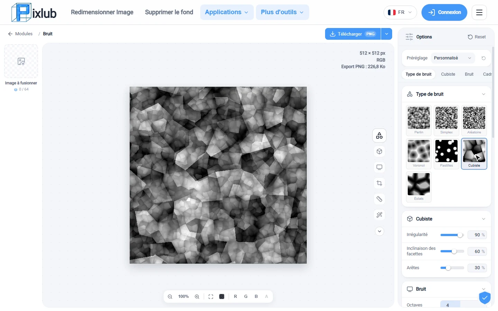

# Bruit

Générer une texture de bruit : Perlin, Voronoï, pastilles, cubiste, éclats…

**Catégorie** : Génération · **Identifiant** : `noise` · [Référence API](./api.md)

## Où l'utiliser

- **[Page du module](https://pixlub.com/fr/module/noise)** : Déposez vos fichiers, réglez, téléchargez : le module seul, sans rien d'autre.
- **[Graphe d'image](https://pixlub.com/fr/image/graph)** : Reliez-le à d'autres modules pour composer un effet plus complexe.

## Entrées

Les fichiers que la page du module accepte : déposez-les sur la zone d’import, ou cliquez dessus pour parcourir. Un fichier d’un autre format est écarté, avec un message qui rappelle les formats permis.

| Entrée | Formats acceptés | Fichiers |
| --- | --- | --- |
| **Image à fusionner** (facultative) Image facultative fusionnée avec le bruit ; reliée, elle en fixe aussi la taille. | `PNG`, `JPEG`, `WebP`, `GIF`, `AVIF`, `BMP` | Un ou plusieurs : chaque image est traitée à part, avec les mêmes réglages |

Le nombre d’images traitées d’un coup dépend de votre offre.

Par l’API, les fichiers et leurs formats sont détaillés dans la [vue API](./api.md).

## Présentation vidéo

▶ [Voir la vidéo](../../../../assets/modules/noise/demo.fr.mp4) : Type de bruit, échelle, graine, puis fusion avec une image.

1. `0:00` Le rendu s’affiche d’emblée
2. `0:01` Choisir le type de bruit
3. `0:05` Échelle et intensité
4. `0:12` Changer la graine
5. `0:15` Fusionner avec une image
6. `0:18` Exporter le résultat

## Utilisation

1. **Ouvrir**

   Le bruit s'affiche tout de suite, sans import.

2. **Choisir le type**

   Cliquez une vignette : **Perlin**, **Simplex**, **Aléatoire**, **Voronoï**, **Pastilles**, **Cubiste** ou **Éclats**.

3. **Régler**

   **Échelle**, **intensité** et **graine** ; les onglets mènent au cadrage et au post-traitement.

## Réglages

| Réglage | Effet |
| --- | --- |
| **Type** | Chacun a sa section de réglages (crêtes, cellules, pastilles…). |
| **Octaves** / **Rampe des octaves** | Couches de détail superposées et leur poids. |
| **Intensité** | Contraste autour du gris moyen, 0 à 400 %. |
| **Graine** | Change le tirage ; une même graine redonne le même bruit. Entre deux entiers, le bruit glisse d'un tirage à l'autre : animée, la graine fait bouger les cellules au lieu de les faire sauter. |
| **Cadrage** | Position, rotation, échelle et recouvrement pour une texture sans couture. |
| **Dimensions** | Largeur et hauteur ; une image fusionnée impose les siennes. |
| **Post-traitement** | Niveaux automatiques, courbe de remap, quantification en aplats. |
| **Fusion** | Méthode de fusion et opacité : comment le réglage se pose sur l'image d'origine. |

## Astuces

- Le **recouvrement** (tuilage) fabrique une texture qui se répète sans couture.
- Déposez une image dans **Image à fusionner** pour poser le bruit dessus (grain, salissure).

## Exportation

Le bouton **Télécharger** enregistre le résultat dans le format du fichier importé : une photo JPEG ressort en JPEG. Le menu à sa droite ouvre les **Paramètres d’export** pour choisir un autre format, régler la qualité, la taille ou le fond, et propose **Copier l’image**.

Avec plusieurs images, le bouton devient **Téléchargement ZIP** ; le menu propose aussi les fichiers séparés, ou la seule image affichée.

- **[La modale d’exportation](../../../../01-app/fr/02-image/04-exportation.md)** : Tous les formats, leurs réglages, le traitement local ou serveur, les lots et le dossier local.
