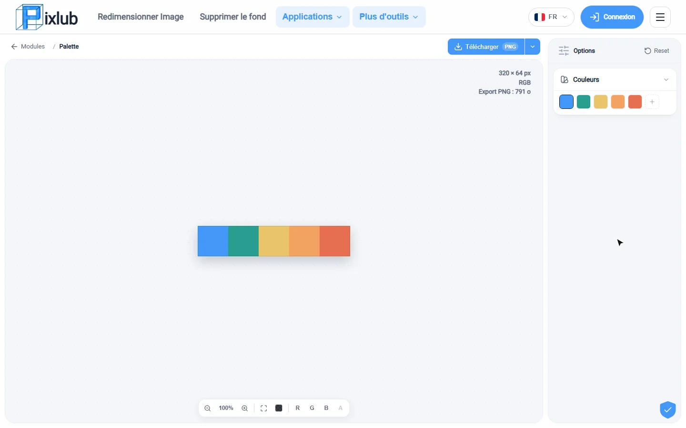

# Palette

Définir une palette de couleurs, à exporter ou à réutiliser dans le graphe.

**Catégorie** : Génération · **Identifiant** : `palette`

## Où l'utiliser

- **[Page du module](https://pixlub.com/fr/module/palette)** : Déposez vos fichiers, réglez, téléchargez : le module seul, sans rien d'autre.
- **[Graphe d'image](https://pixlub.com/fr/image/graph)** : Reliez-le à d'autres modules pour composer un effet plus complexe.

## Entrées

Ce module n’a pas d’entrée : il crée l’image à partir de ses seuls réglages.

## Présentation vidéo

▶ [Voir la vidéo](../../../../assets/modules/palette/demo.fr.mp4) : Modifier une couleur, en ajouter une.

1. `0:00` Le rendu s’affiche d’emblée
2. `0:01` Modifier une couleur
3. `0:06` Ajouter une couleur
4. `0:09` Exporter le résultat

## Utilisation

1. **Modifier une couleur**

   Cliquez une pastille, puis choisissez la couleur (HEX, nuancier ou pipette).

2. **Ajouter ou retirer**

   **+** ajoute une couleur ; jusqu'à 32.

## Réglages

| Réglage | Effet |
| --- | --- |
| **Couleurs** | 1 à 32 couleurs, rendues en bandes. |

## Astuces

- Dans le [graphe d'image](../../../../01-app/fr/02-image/01-image-graph.md), une palette alimente les modules qui recolorent.

## Exportation

Le bouton **Télécharger** enregistre le résultat dans le format du fichier importé : une photo JPEG ressort en JPEG. Le menu à sa droite ouvre les **Paramètres d’export** pour choisir un autre format, régler la qualité, la taille ou le fond, et propose **Copier l’image**.

- **[La modale d’exportation](../../../../01-app/fr/02-image/04-exportation.md)** : Tous les formats, leurs réglages, le traitement local ou serveur, les lots et le dossier local.
